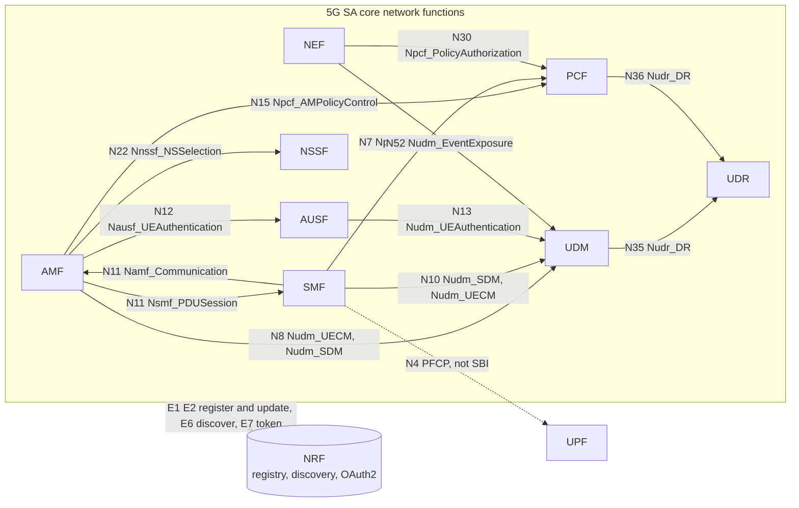
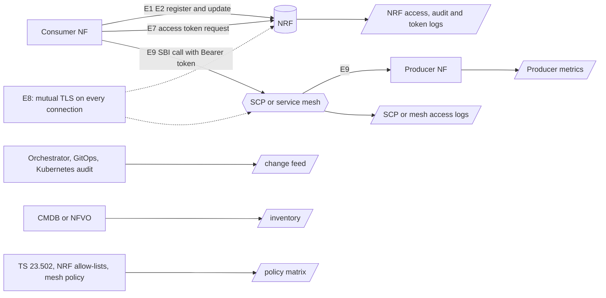

# ML-based detection of cyber-attacks and misconfigurations in a 5G core, monitoring NRF registrations and NF-to-NF service calls 

**Anomaly detection on 5G SA core signalling: rogue or changed NF registrations in the NRF and new NF-to-NF call edges on the SBI, with six model families compared in MLflow.**

This repository is an end-to-end experiment for a communications service provider (CSP):

1. **Simulate** 45 days of 5G SA core telemetry (NRF registrations, OAuth2 token requests, SCP call roll-ups, inventory and change feed), with injected attacks and realistic benign changes.
2. **Build 14 security features** per NF instance and per hour from that telemetry.
3. **Train and compare six anomaly-detection model families** (from a RobustZ baseline to rules, unsupervised ML, supervised ML and a hybrid), with every run, metric and model tracked in **MLflow**.

> All data in this repository is **synthetic**. The results show that the feature set and the comparison pipeline work, not how the models would perform on a real network. The data sources section explains how to replace the simulator with real NRF, SCP and inventory data.

---

## Table of contents

1. [Overview and scope](#1-overview-and-scope)
2. [Network functions and SBI interfaces involved](#2-network-functions-and-sbi-interfaces-involved)
3. [Data sources: where the fields come from and how to get them in a real network](#3-data-sources-where-the-fields-come-from-and-how-to-get-them-in-a-real-network)
4. [The 14 features](#4-the-14-features)
5. [Simulated anomalies and benign look-alikes](#5-simulated-anomalies-and-benign-look-alikes)
6. [Repository files](#6-repository-files)
7. [How to run](#7-how-to-run)
8. [Machine learning models and evaluation protocol](#8-machine-learning-models-and-evaluation-protocol)
9. [Results](#9-results)
10. [Conclusions](#10-conclusions)
11. [Limitations](#11-limitations)
12. [Next steps](#12-next-steps)
13. [References](#13-references)

---

## 1. Overview and scope

### The problem

In a 5G SA core, network functions (NFs) find and call each other through the **NRF** (Network Repository Function). Every NF registers a profile in the NRF (its type, address, services, the subscriber ranges it serves and which NF types may call it). Consumers then discover producers through the NRF and obtain OAuth2 access tokens from it before calling them.

The NRF profile is therefore the **root of trust** of the service-based architecture. If an attacker or a faulty change corrupts it, everything downstream behaves "correctly" against a poisoned source of truth.

### What this experiment detects

The experiment focuses on one family of anomalies with two complementary views:

| View | Question | Examples |
|---|---|---|
| **Registry view** (NRF) | Who is allowed to exist in the NRF, and with which profile? | A fake UDM registers; a real NF's address is changed; a producer's allow-list is widened |
| **Graph view** (SBI calls) | Who actually calls whom, for which service and operation? | An AMF suddenly calls a UDR service it never used; forbidden calls succeed |

A **call edge** is the triple `consumer NF type | service | operation`, for example `AMF | Nudm_SDM | GET /{supi}/am-data`. The set of normal edges is stable and dictated by 3GPP procedures, so a new edge is a strong signal of lateral movement or of a misconfiguration.

### Why it is hard

Many legitimate operations look like attacks: autoscaling, rolling upgrades, disaster-recovery (DR) failover, NRF restarts with mass re-registration, certificate rotation, late CMDB updates. A useful detector must separate **rare but planned** from **rare and malicious**. The simulator generates these benign look-alikes on purpose, and the evaluation measures false alarms on each of them.

---

## 2. Network functions and SBI interfaces involved

### NFs, services and reference points used in the experiment

Each arrow is a call edge of the normal baseline (consumer → producer), labelled with the 3GPP reference point and the producer service. All NFs also register with the NRF and request tokens from it.



These 12 services and 15 call edges (drawn as 13 arrows, because the AMF→UDM and SMF→UDM arrows each carry two services) are the `EDGES` dictionary in `NRF_synthetic_data.py`. They define the normal traffic, the policy matrix (which consumer types may call each service) and the NEF edges approved when the NEF goes live. The UPF uses PFCP on N4, not the SBI, and has no normal SBI consumer edges. It only appears as a consumer in lateral-movement attacks.

### Where the events are observed

All SBI traffic is HTTP/2 over mutual TLS. With indirect communication, consumer calls go through the SCP (Service Communication Proxy) or a service mesh. That is why the consumer identity must be taken from SCP logs or from the access token, not from the producer's view of the connection.



### Event tags E1 to E9

E1–E9 are this project's own shorthand for "the protocol event a feature is extracted from". They are not 3GPP names. Each maps to a 3GPP operation, except E8, which is the TLS layer under every SBI connection.

| Tag | Name | 3GPP service / mechanism | HTTP request | From → to | Spec | Observed at | In the simulation |
|---|---|---|---|---|---|---|---|
| **E1** | NF registration | Nnrf_NFManagement, NFRegister | `PUT /nnrf-nfm/v1/nf-instances/{nfInstanceId}` | NF → NRF | TS 29.510 | NRF access or audit log | `nrf_events.csv`, `REGISTER` |
| **E2** | NF profile update (also heartbeats) | Nnrf_NFManagement, NFUpdate | `PATCH` (JSON Patch) or `PUT` on the same resource | NF → NRF | TS 29.510 | NRF access or audit log | `nrf_events.csv`, `UPDATE` (no heartbeats) |
| E3 | NF deregistration | Nnrf_NFManagement, NFDeregister | `DELETE /nnrf-nfm/v1/nf-instances/{nfInstanceId}` | NF → NRF | TS 29.510 | NRF access log | not generated |
| E4 | Status subscription | Nnrf_NFManagement, NFStatusSubscribe | `POST /nnrf-nfm/v1/subscriptions` | NF → NRF | TS 29.510 | NRF access log | not generated |
| E5 | Status notification | Nnrf_NFManagement, NFStatusNotify | `POST` to the subscriber's callback URI | NRF → NF | TS 29.510 | NRF outbound log | not generated |
| E6 | NF discovery | Nnrf_NFDiscovery | `GET /nnrf-disc/v1/nf-instances?target-nf-type=…` | NF or SCP → NRF | TS 29.510 | NRF access log | not generated |
| **E7** | Access token request | Nnrf_AccessToken (OAuth 2.0 client credentials) | `POST /oauth2/token` | NF → NRF | TS 29.510, TS 33.501 | NRF token-endpoint log | `token_requests.csv` |
| **E8** | TLS identity | Mutual TLS handshake (not a 3GPP message) | none: certificate SAN, fingerprint, source IP | both sides | TS 33.501 | Where TLS terminates: NRF, SCP, sidecar | `src_ip`, `cert_san`, `cert_fp` in `nrf_events.csv` |
| **E9** | SBI service call | Any NF-to-NF service | Any method and path, `Authorization: Bearer <token>` | consumer → producer, directly or via SCP | TS 29.500, TS 23.501 Annex E | SCP or mesh access logs, producer metrics | `sbi_calls.csv`, `producer_load.csv`, `post_register_traffic.csv` |

---

## 3. Data sources: where the fields come from and how to get them in a real network

The simulator writes the **raw tables** a real deployment would collect. The features are computed later by `NRF_features.py`, so replacing the simulator with real data only requires filling the same tables (see `load_raw()`).

### The 10 raw tables

| Table | Grain | Key columns | Simulated from | Real-world source |
|---|---|---|---|---|
| `inventory.csv` | one row per approved NF instance (45) | `nf_instance_id`, `nf_type`, `fqdn`, `approved_ips` (primary and DR), `live_from`, `known_from` | instance catalogue | CMDB or NFVO inventory |
| `policy_matrix.csv` | one row per (service, allowed consumer type) (15) | `service`, `allowed_consumer_type` | `EDGES` | TS 23.502 consumer lists, NRF `allowedNfTypes`, mesh authorization policy |
| `change_feed.csv` | one row per orchestrator event or maintenance window (193) | `kind`, `nf_instance_id`, `ts_start`, `ts_end`, `approved_edges`, `approved_from` | scenario code | Orchestrator, GitOps, Kubernetes audit log, change calendar (ITSM) |
| `nrf_events.csv` | one row per NRF registration or update (1,647) | profile fields, `changed_paths`, `n_ranges_added`, `n_allowlist_added`, TLS identity | scenario code | NRF access or audit log (E1, E2) + TLS metadata (E8) |
| `post_register_traffic.csv` | one row per registration (258) | `ttft_s`, `requests_10m`, `type_requests_10m` | drawn per scenario | Join of E1 with the first E9 requests received |
| `token_requests.csv` | one row per instance and hour (27,051) | `n_requests`, `n_sub_mismatch` | normal rates + attacks | NRF token-endpoint log (E7) joined with E8 |
| `sbi_calls.csv` | one row per hour, consumer instance, service, operation, token scope (85,654) | `consumer_type`, `service`, `operation`, `token_scope_service`, `n_calls`, `n_2xx`, `n_401`, `n_403`, `n_5xx` | `EDGES` + attacks | SCP or mesh access logs (E9) |
| `producer_load.csv` | one row per live instance and hour (38,747) | `n_requests_received` | `PRODUCER_LOAD` | Producer metrics or SCP logs grouped by destination |
| `labels.csv` | one row per non-normal instance-hour (844) | `label`, `subtype`, `episode_id` | injected episodes | SOC incidents, red-team or injected tests |
| `episodes.csv` | one row per anomaly episode (110) | `episode_id`, `subtype`, `start_window` | injected episodes | incident records |

`meta.json` stores the start time, the number of days, the baseline length and counts.

### How to obtain each group of fields in a real network

**NRF registry events (E1, E2).**
- Read the NRF's access or audit log for `PUT` and `PATCH` on `/nnrf-nfm/v1/nf-instances/{id}`, or take periodic snapshots of all profiles with `GET /nnrf-nfm/v1/nf-instances` and compare them.
- `changed_paths` is the list of JSON Patch paths in an update, or the list of fields that differ between two consecutive profiles of the same instance.
- `n_allowlist_added` and `n_ranges_added` come from comparing the arrays in the old and new profile: `allowedNfTypes`, `allowedNssais`, `allowedOperationsPerNfType`, and `supiRanges`, `gpsiRanges`, TAIs, DNNs, S-NSSAIs in the type-specific info (`udmInfo`, `smfInfo`, …).

**TLS identity (E8).**
- Capture the client certificate SAN, its fingerprint and the TCP source IP where TLS terminates: on the NRF, the SCP or the mesh sidecar.
- Passive probes cannot read HTTP/2 inside TLS 1.3 without keys, so collect at the termination point, not on the wire.

**Access tokens (E7).**
- From the NRF token endpoint: the request carries `nfInstanceId`, `nfType`, `targetNfType` and `scope`; the issued token carries the claims `sub`, `aud`, `scope` and `exp`.
- `n_sub_mismatch` counts requests whose claimed identity (`nfInstanceId` / `sub`) differs from the TLS certificate identity.
- Log the claims or a hash of the token, never the raw token: it is a bearer credential.

**SBI calls (E9).**
- Use SCP or service-mesh access logs (for example Envoy): method, path, status code, consumer identity, destination.
- The consumer identity must come from the SCP or from the token claims (`sub`), because with indirect communication the producer only sees the SCP.
- `operation` is the path reduced to a template (`/{supi}/am-data`), so millions of URLs collapse into one edge.
- `token_scope_service` is the service named in the token's `scope` or `aud`.
- `producer_load` and the post-registration traffic come from the same logs grouped by destination, or from producer metrics (for example Prometheus counters).

**Inventory, change control and policy.**
- `inventory.csv`: CMDB or NFVO, including approved IPs per instance and the time each entry was created (`known_from`).
- `change_feed.csv`: orchestrator events per instance, GitOps commits, Kubernetes audit events and the approved maintenance calendar. `approved_edges` corresponds to new call relationships declared in a change ticket.
- `policy_matrix.csv`: start from the TS 23.502 "known NF service consumers", reconcile with the live NRF allow-lists and the mesh authorization policy, and keep it under version control. Mismatches between these sources are findings in themselves.

**Practical points.**
- Synchronise clocks (NTP) on the NRF, SCP and orchestrator, and allow a tolerance when joining (the experiment uses ±10 minutes for orchestrator events).
- Map instance IDs to IPs and certificates consistently across sources.
- Build the instance-hour universe from the union of the NRF registry, SCP logs and inventory, so that an unknown instance with no metrics is still scored.

---

## 4. The 14 features

`NRF_features.py` produces one row per NF instance per hour with **14 features in 16 columns** (items 5 and 10 each have two columns). Event features are neutral in hours without an event. State features (address, certificate) are carried forward until the next NRF event.

| # | Column | Definition | Source events |
|---|---|---|---|
| 1 | `id_in_inventory` | Instance ID known to the CMDB at that hour | E1/E2 + inventory |
| 2 | `addr_in_inventory` | Registered FQDN and IP match the approved ones (state) | E1/E2 + inventory |
| 3 | `cert_matches_profile` | Certificate SAN equals the registered FQDN (state) | E8 + E1/E2 |
| 4 | `second_source_for_id` | Same ID seen with a different certificate or source IP than its previous event, held 6 h | E1/E2 + E8 |
| 5 | `orch_event_matched` | Material change matched by an orchestrator event within ±10 min | E1/E2 + orchestrator |
| 5 | `in_change_window` | Material change inside a maintenance window | E1/E2 + calendar |
| 6 | `diff_risk_score` | Sum of risk weights of the changed profile paths (addresses and allow-lists high, load low) | E2 / E1 |
| 7 | `allowlist_widened` | Entries added to the profile allow-lists | E1/E2 |
| 8 | `ranges_added` | SUPI ranges, TAIs, S-NSSAIs and similar added | E1/E2 |
| 9 | `token_sub_matches_cert` | All token requests came from the identity they claimed | E7 + E8 |
| 10 | `time_to_first_traffic_s` | Seconds from registration to the first request received (capped at 3600) | E1 + E9 |
| 10 | `new_instance_traffic_share_10m` | Share of the NF type's traffic served in the 10 minutes after registration | E1 + E9 |
| 11 | `edge_is_new` | Call rows on edges not seen in the 10-day baseline and not approved by a change | E9 |
| 12 | `edge_policy_violation` | Call rows answered 2xx although the consumer type is not allowed for the service | E9 + policy |
| 13 | `token_scope_vs_call_mismatch` | Share of calls whose token was issued for a different service | E9 (+ E7) |
| 14 | `edge_403_ratio` | Share of denied calls (401 + 403) on new edges | E9 |

Before modelling, `risk_matrix()` turns the 16 columns into inputs where **higher always means more suspicious**: "good = 1" flags are inverted, counts are log-scaled (`log1p`), time to first traffic becomes `1 / (1 + t/60)`, and ratios stay as they are.

---

## 5. Simulated anomalies and benign look-alikes

### Five anomaly types (110 episodes, 2–6 hours each)

| Type | What is attacked | NRF event | Identity looks clean? | Main traces |
|---|---|---|---|---|
| `rogue_impostor` | A **new** fake NF registers with priority 1 and capacity 65000 to attract traffic. Variants: noisy, stealth, and squatting a reserved inventory ID with its approved IP. | REGISTER | Sometimes (reserved variant) | Unknown ID or address, certificate mismatch, no orchestration, fast traffic grab, token mismatch, new edges |
| `duplicate_id` | A **real** NF's ID is registered again from another source | REGISTER | No | Second source for the ID, unknown address, no orchestration, high diff score |
| `hijack` | A **real** NF's address is changed by an update. Stealth variant uses the approved DR IP and a stolen certificate. | UPDATE | Sometimes (stealth) | Second source, no orchestration, outside the window |
| `privilege_widening` | A **real** producer's allow-list is widened; a forbidden consumer type then calls it successfully | UPDATE | Yes | Allow-list and range additions, then new edge + policy violation + scope mismatch on the consumer |
| `lateral_edge` | A **real** NF calls a service it should not. Enforcement-gap, probing and low-and-slow variants. | none | Yes | New edge, policy violation, denied share on new edges, token scope mismatch |

Episodes on real instances end with an orchestrated **remediation** that restores the profile.

### Benign changes generated on purpose

| Benign change | Why it looks suspicious |
|---|---|
| Autoscale, NEF go-live | New instance registration; the NEF also creates new call edges (approved 6 h later) |
| CMDB lag (24 h) | Unknown ID and address, although orchestrated |
| Rolling upgrade | Re-registration with changed features |
| Slice launch | Ranges and allow-list entries added |
| DR failover and failback | Address change and a new source for the ID |
| NRF restart | Every NF re-registers within minutes, without orchestration, with fast traffic |
| Certificate rotation, pod reschedule | New fingerprint or source IP for the same ID |
| Feature trial (6 h) | New edge answered 2xx but missing from a stale policy matrix |
| Late orchestrator events (8 %) | The orchestration match fails although the change was planned |
| Remediation | Address or allow-list change right after an incident |

---

## 6. Repository files

| File | What it does | Main contents |
|---|---|---|
| `NRF_requirements.txt` | Python packages to install | numpy, pandas, scikit-learn, scipy, matplotlib, joblib, mlflow, tabulate (optional) |
| `NRF_synthetic_data.py` | Generates the 10 raw tables and `meta.json` | `EDGES` (normal call graph), `Simulator` class: instance catalogue, normal traffic, benign events, anomaly injection, CSV output. Options: `--out`, `--days`, `--baseline-days`, `--episodes`, `--seed`. |
| `NRF_features.py` | Builds the feature table from the raw tables | `load_raw()`, `build_features()` (16 feature columns + labels per instance-hour), `risk_matrix()` (model inputs), `split_masks()` (time-based train / validation / test) |
| `NRF_train.py` | Trains the six model families and logs everything to MLflow | Model classes, hyper-parameter grids, threshold selection, metrics (`evaluate()`), MLflow runs, MLflow model registration (`ScoreModel`), `artifacts/` outputs |
| `NRF_test.py` | Scores the frozen best models on the untouched test period | Loads `artifacts/best_models.json` and the models, computes test metrics, writes the comparison report and charts, logs a `test_comparison` run to MLflow |

### Outputs

| Folder / file | Produced by | Content |
|---|---|---|
| `data/` | `NRF_synthetic_data.py` | The 10 CSV tables and `meta.json` |
| `artifacts/models/<family>.joblib` | `NRF_train.py` | Best model of each family |
| `artifacts/best_models.json` | `NRF_train.py` | Best hyper-parameters, frozen thresholds, MLflow run IDs, validation metrics, data fingerprint |
| `artifacts/validation_summary.csv` | `NRF_train.py` | Best trial per family with its validation metrics |
| `results/` | `NRF_test.py` | `test_comparison.csv/.md`, `test_subtype_recall.csv`, `test_benign_fp.csv`, `pr_curves.png`, `subtype_recall.png`, `benign_fp.png` |
| MLflow | `NRF_train.py`, `NRF_test.py` | Experiment `nrf/rogue_registration_and_call_edges`: 6 family runs with 31 nested trial runs, a `test_comparison` run with 6 nested runs, and 6 registered models `nrf-<family>` |

---

## 7. How to run

### Install

```bash
python -m venv .venv
source .venv/bin/activate            # Windows PowerShell: .venv\Scripts\Activate.ps1
pip install -r NRF_requirements.txt
```

Python 3.11 or later is recommended (tested with 3.13).

### Start MLflow

`NRF_train.py` logs by default to an MLflow server at `http://127.0.0.1:5000`. Start one in a separate terminal from the project folder:

```bash
mlflow server --backend-store-uri sqlite:///mlflow.db --port 5000
```

The same address serves the MLflow interface. Alternatively, log directly to a local database without a server with `--tracking-uri sqlite:///mlflow.db`, and view it with `mlflow ui --backend-store-uri sqlite:///mlflow.db`.

### Run the pipeline

```bash
python NRF_synthetic_data.py --out data      # 1. raw tables (seed 7, 45 days, 110 episodes)
python NRF_train.py                          # 2. 6 families, 31 trials, MLflow runs, artifacts/
python NRF_test.py                           # 3. test scores, results/, MLflow test runs
python NRF_features.py --data-dir data       # optional: feature averages per subtype
```

Then open `http://127.0.0.1:5000` and select the experiment `nrf/rogue_registration_and_call_edges`. Expand a family run to see its trials, filter with `tags.run_level = 'family'`, and use **Compare** to view runs side by side. The registered models appear on the **Models** page.

Useful options:

| Script | Option | Default | Purpose |
|---|---|---|---|
| `NRF_synthetic_data.py` | `--days`, `--baseline-days`, `--episodes`, `--seed` | 45, 10, 110, 7 | Size and randomness of the dataset |
| `NRF_train.py` | `--families` | all six | Train only some families |
| `NRF_train.py` | `--target-fpr` | 0.005 | False-positive rate used to freeze the alert threshold |
| `NRF_train.py`, `NRF_test.py` | `--tracking-uri`, `--experiment` | server, `nrf/rogue_registration_and_call_edges` | Where and under which name to log |

Run the three steps in order from the project folder: the scripts use relative paths (`data/`, `artifacts/`, `results/`). If you regenerate the data, retrain before testing; `NRF_test.py` warns when the data fingerprint differs from the one used for training.

---

## 8. Machine learning models and evaluation protocol

### The six families

Every family implements `fit(X)` and `score(X)` on the 16-column risk matrix; a higher score means more suspicious.

| Family | Approach | Trained on | Hyper-parameters tried | Role |
|---|---|---|---|---|
| `robust_z` | Per-feature median and MAD, one-sided z-score (only "riskier than usual" counts), summed or max-ed. `eps` is a scale floor so rare 0/1 flags count as 1/eps. | normal rows | `eps` {0.1, 0.25, 0.5} × `zmax` {4, 8} × `agg` {sum, max} (12) | **Baseline** |
| `isolation_forest` | Random trees isolate unusual rows in few splits | normal rows | trees {200, 500} × samples {256, 1024} × features {0.6, 1.0} (8) | Standard unsupervised detector |
| `lof` | Local Outlier Factor (novelty mode): density compared with neighbours | ≤ 12,000 sampled normal rows | neighbours {10, 30, 60} (3) | Density-based alternative |
| `hist_gbm` | Supervised gradient-boosted trees, balanced class weights | all training rows with labels | learning rate {0.05, 0.1} × leaves {15, 31} (4) | Potential when labels exist |
| `rules_only` | Fixed weighted sum of identity and policy checks (`strict` or `balanced` weights) | nothing | profile {strict, balanced} (2) | **Must-beat** expert reference |
| `hybrid_rules_iforest` | Strict rules + `alpha` × Isolation Forest percentile rank | normal rows (IF part) | `alpha` {2, 5}, 300 trees (2) | Rules for hard checks, ML for ranking |

The mix covers statistics, unsupervised trees, density, supervised learning, expert rules and a hybrid. The data is mostly rare 0/1 flags with about 1 % anomalous rows, which favours rules and trees over distance-based methods. Each family is wrapped as an MLflow `pyfunc` model (`ScoreModel`) and registered as `nrf-<family>`.

### Protocol

- **Unit:** one row per NF instance per hour (38,745 rows).
- **Time-based split**, never random, so that hours of the same episode never leak between splits:

| Split | Period | Rows | Anomalous rows | Episodes | Used for |
|---|---|---|---|---|---|
| Train | until 2 Feb (includes the 10-day clean baseline) | 23,117 | 239 | 60 | Fitting the models |
| Validation | 2–9 Feb | 6,166 | 103 | 22 | Choosing hyper-parameters and freezing the alert threshold |
| Test | 9–19 Feb | 9,462 | 111 | 28 | Final, untouched scoring and comparison |

- **Best trial per family:** highest validation PR-AUC (ties: episode recall).
- **Alert threshold:** the score exceeded by only 0.5 % of validation's normal rows, then frozen for test.

### Metrics (identical for all families)

| Metric | Definition |
|---|---|
| `pr_auc` | Area under the precision–recall curve, threshold-free. Random ≈ share of anomalous rows (~0.01). **Main ranking metric.** |
| `roc_auc` | Threshold-free; looks high for every family because normal rows dominate |
| `recall_at_fpr` | Share of anomalous hours alerted at the frozen threshold |
| `precision`, `fpr`, `f1` | Real alerts / all alerts; alerted normal hours / normal hours; balance of the two |
| `alerts_per_day` | Analyst workload |
| `fp_per_day_benign`, `benign_fpr` | False alarms on benign-change hours, per day and as a share |
| `episode_recall` | Share of attack episodes with at least one alert |
| `mttd_h` | Mean hours from an episode's start to its first alert (detected episodes only) |
| `ep_recall_<subtype>`, `benign_fp_<subtype>` | Episode recall per attack type; alert share per benign change |

---

## 9. Results

Seed 7, default settings. Thresholds were frozen on validation.

### Validation (best trial per family)

| Family | PR-AUC | Recall @ FPR | Episode recall | Alerts / day | Benign FP / day |
|---|---|---|---|---|---|
| hybrid_rules_iforest | **0.810** | 0.796 | 0.864 | 15.3 | 3.6 |
| robust_z | 0.789 | 0.767 | 1.000 | 13.6 | 2.3 |
| hist_gbm | 0.745 | 0.612 | 0.818 | 9.0 | 0.0 |
| rules_only | 0.709 | 0.709 | 0.909 | 14.6 | 4.1 |
| isolation_forest | 0.612 | 0.689 | 1.000 | 14.6 | 4.3 |
| lof | 0.464 | 0.350 | 0.409 | 8.3 | 3.1 |

### Test

| Family | PR-AUC | ROC-AUC | Recall @ FPR | Precision | F1 | Alerts / day | Benign FP / day | Episode recall | MTTD (h) | Gap vs val |
|---|---|---|---|---|---|---|---|---|---|---|
| hybrid_rules_iforest | **0.853** | 0.992 | 0.829 | 0.736 | 0.780 | 12.5 | 3.2 | 0.857 | 0.04 | +0.043 |
| hist_gbm | 0.808 | 0.991 | 0.694 | **1.000** | **0.819** | 7.7 | **0.0** | 0.714 | 0.10 | +0.063 |
| rules_only | 0.766 | 0.988 | 0.757 | 0.689 | 0.721 | 12.2 | 3.7 | 0.929 | 0.04 | +0.057 |
| robust_z | 0.683 | 0.988 | 0.847 | 0.475 | 0.608 | 19.8 | 10.4 | 1.000 | 0.00 | −0.106 |
| lof | 0.573 | 0.934 | 0.423 | 0.662 | 0.516 | 7.1 | 2.4 | 0.536 | 1.07 | +0.109 |
| isolation_forest | 0.386 | 0.981 | 0.766 | 0.423 | 0.545 | 20.1 | 11.3 | 1.000 | 0.04 | −0.226 |

### Test episode recall per anomaly type

| Family | duplicate_id | hijack | lateral_edge | privilege_widening | rogue_impostor |
|---|---|---|---|---|---|
| hybrid_rules_iforest | 1.00 | 0.40 | 1.00 | 1.00 | 0.89 |
| hist_gbm | 1.00 | 0.40 | 0.80 | 1.00 | 0.56 |
| rules_only | 1.00 | 1.00 | 0.60 | 1.00 | 1.00 |
| robust_z | 1.00 | 1.00 | 1.00 | 1.00 | 1.00 |
| lof | 0.83 | 0.40 | 0.20 | 0.00 | 0.78 |
| isolation_forest | 1.00 | 1.00 | 1.00 | 1.00 | 1.00 |

### Test share of benign-change hours alerted (lower is better)

| Family | autoscale | cert rotation | CMDB lag | DR failover | feature trial | NRF restart | pod reschedule | remediation | rolling upgrade |
|---|---|---|---|---|---|---|---|---|---|
| hybrid_rules_iforest | 0.33 | 0.00 | 1.00 | 0.00 | 0.55 | 0.01 | 0.00 | 0.07 | 0.00 |
| hist_gbm | 0.00 | 0.00 | 0.00 | 0.00 | 0.00 | 0.00 | 0.00 | 0.00 | 0.00 |
| rules_only | 0.33 | 0.00 | 1.00 | 1.00 | 0.09 | 0.04 | 0.00 | 0.50 | 0.00 |
| robust_z | 0.33 | 0.00 | 0.09 | 1.00 | 0.55 | 1.00 | 0.00 | 0.71 | 0.50 |
| lof | 0.00 | 0.00 | 1.00 | 0.00 | 0.00 | 0.01 | 0.00 | 0.00 | 0.00 |
| isolation_forest | 0.67 | 0.00 | 0.00 | 1.00 | 1.00 | 1.00 | 0.00 | 0.93 | 0.75 |

### Reading the results

- **The hybrid is the best overall choice.** It ranks first on validation, where the choice is made, and stays first on test with a small gap (+0.04). It produces about 12.5 alerts per day, 74 % of them real, catches 86 % of the attacks, almost always in the first hour. Nearly all its false alarms are benign-change hours, mainly **CMDB lag** (100 %) and **feature trials** (55 %).
- **Its weak spot is the hijack** (2 of 5 caught). A stealth hijack only raises "second source", "no orchestration" and "outside the window", which have low weights in the strict rules and stay under the hybrid's threshold. `rules_only` catches all of them, so the signal exists.
- **HistGBM is the quietest**: zero false alarms and precision 1.0, because it learned from labels that NRF restarts and DR failovers are normal. It misses stealthy variants (56 % of impostors, 40 % of hijacks): it recognises what it has seen.
- **RobustZ and Isolation Forest catch every attack but alert on every NRF restart.** Their thresholds were frozen on a validation week **without any NRF restart**, while the test period contains two (79 benign hours). That explains their negative gaps (−0.11 and −0.23) and their 10–11 benign false alarms per day: they find "rare", not "malicious".
- **LOF** is not suited to these mostly-binary features: it misses about half the attacks and every privilege widening.
- **ROC-AUC is uninformative here** (0.93–0.99 for every family); PR-AUC and the threshold-based metrics separate the families.
- **Small numbers:** the test period has 28 episodes (5 hijacks), so per-type recall moves in steps of 20 percentage points. Differences between close families should be confirmed on several seeds.

---

## 10. Conclusions

1. **The 14 features separate the five anomaly types from normal traffic**, and the registry view (identity, orchestration, profile diff) and the graph view (new edges, policy violations, token misuse) complement each other: identity checks catch impostors and duplicates, call-edge features catch lateral movement and privilege abuse that leave the registry untouched.
2. **Domain knowledge beats pure anomaly detection.** Families that use rules or labels (hybrid, rules, HistGBM) tell rare-but-benign from rare-and-malicious; pure detectors (RobustZ, Isolation Forest, LOF) alert on every rare legitimate event, such as an NRF restart.
3. **The recommended design is a hybrid**: hard identity and policy rules for the clear-cut checks, with ML ranking the rest. With labels, a supervised model adds a high-precision tier.
4. **Change-control data is essential.** Orchestrator events, the maintenance calendar, an up-to-date CMDB and an independent policy matrix are what turn "something changed" into "something unauthorised changed". Most of the remaining false alarms come from gaps in these sources (CMDB lag, stale policy).
5. **One validation period is not enough.** The event mix differs between weeks (no NRF restart in validation, two in test), so model selection should use several time folds or several datasets.

---

## 11. Limitations

- **Synthetic data.** All rates, probabilities and weights are assumptions; the generator tests the pipeline logic, not real-network performance.
- **Hourly roll-ups.** Calls, tokens and load are hourly aggregates; detection time cannot be finer than one hour, and short attacks are diluted (for example the token-scope mismatch ratio).
- **Tables are linked but not fully reconciled.** Normal traffic does not react to NRF events (a hijack does not move the legitimate instance's traffic), the post-registration share is drawn independently of the call tables, and producer load is not the sum of consumer calls.
- **The policy matrix equals the normal traffic by construction** (both come from `EDGES`), except where it is deliberately stale (feature trials).
- **Probing lateral edges keep about 5 % of 2xx responses** because the denial rates do not sum to 100 %, so they can also trigger the policy-violation feature.
- **Features keyed by instance ID**: when an attacker reuses a real ID, its activity is merged with the legitimate instance's row.
- **`id_in_inventory` checks `known_from` only**: a reserved but never-deployed ID passes; checking `live_from` too would catch the reserved-ID impostor.
- **The raw traffic share depends on the number of peers** of each NF type (an NSSF restart scores 0.5, a UDM duplicate 0.37).
- **Single seed, single time split**, and the random seed is not recorded in `meta.json`.

---

## 12. Next steps

**Improve the hybrid**
- Make the identity rules **orchestration-aware**: an unknown ID or address counts much less when the registration matched an orchestrator event (removes most CMDB-lag false alarms).
- Add a dedicated **hijack rule**: "second source **and** no orchestration" with a higher weight.
- Replace the raw traffic share with **`share_vs_fair = share × number of registered instances of the type`**.
- Check `live_from` as well as `known_from` in `id_in_inventory`.

**Make the evaluation robust**
- Run the pipeline on **5–10 seeds** and report mean ± spread.
- Add **rolling time-based folds** and bootstrap confidence intervals per episode.
- Retrain the chosen models on train + validation before deployment.
- Record the seed in `meta.json`; fix the probing 2xx rate in the generator.

**Extend the models and features**
- Add **lag features** (rolling maximum over 6 h and 24 h per instance) to Isolation Forest and HistGBM, then a small **GRU autoencoder** on 12-hour per-instance sequences (past only), and compare.
- Add ECOD / HBOS and logistic regression as cheap extra baselines.
- Add features from the events not yet used: **E6** discovery sweeps, **E4/E5** subscriptions and callbacks pointing outside the domain, **E3** deregistration loops.
- Use a longer post-registration window (60 min) to catch slow-ramping impostors.

**Move towards production**
- Replace `NRF_synthetic_data.py` with an ingestion pipeline that fills the same raw tables from NRF, TLS, SCP, CMDB and orchestrator sources; only `load_raw()` needs to change.
- Build the instance-hour universe from the union of NRF registry, SCP logs and inventory.
- Tiered alerting: supervised model for high-severity alerts, hybrid for the analyst queue; feed analyst verdicts back as labels.
- Serve the registered `nrf-<family>` models from the MLflow Model Registry.

---

## 13. References

- 3GPP TS 23.501: System architecture for the 5G System (SBA, NF services, SCP and indirect communication, Annex E)
- 3GPP TS 23.502: Procedures for the 5G System (NF services and their known consumers)
- 3GPP TS 29.500: 5G System; Technical realization of Service Based Architecture
- 3GPP TS 29.510: Network function repository services (NFManagement, NFDiscovery, AccessToken)
- 3GPP TS 33.501: Security architecture and procedures for 5G System (mutual TLS, OAuth 2.0 authorisation)
- 3GPP TS 29.244: PFCP (N4), for the SMF–UPF interface
- MLflow documentation: https://mlflow.org/docs/latest/
