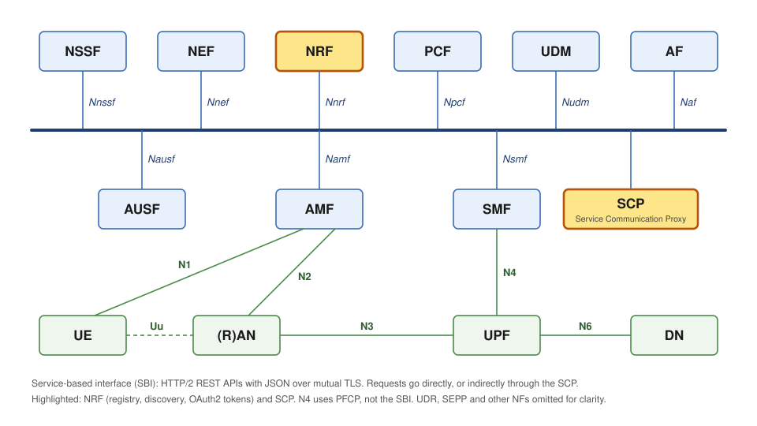
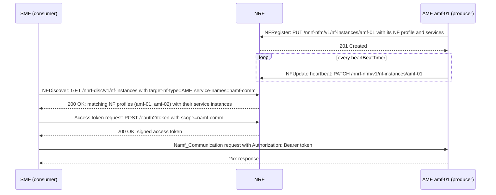
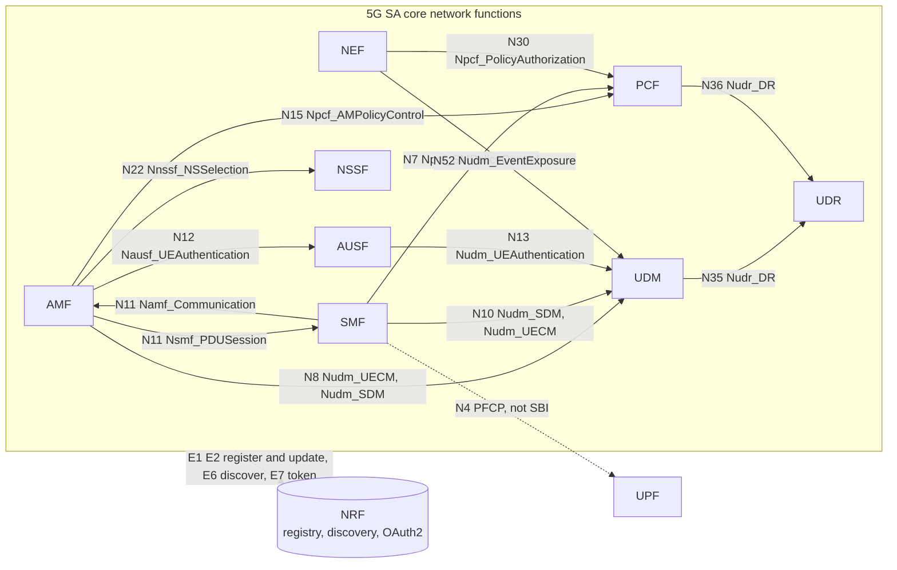
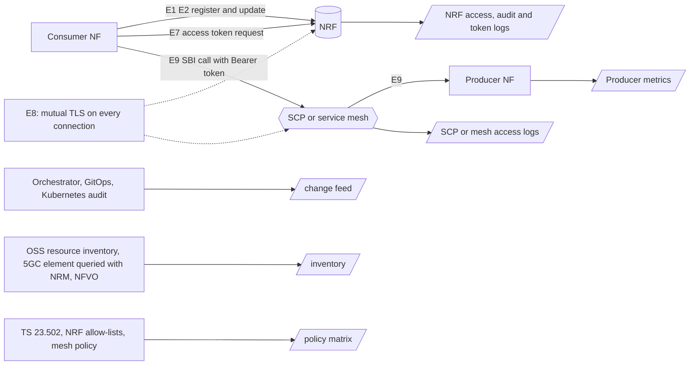

# Detection of attacks and misconfigurations in a 5G core, monitoring NRF registrations and NF-to-NF service calls : Files, Models and Test Results

---

## Table of contents

1. [What is the NRF in the 5G core](#1-what-is-the-nrf-in-the-5g-core)
    - [The role of the NRF](#the-role-of-the-nrf)
    - [What the NRF stores: the NF profile](#what-the-nrf-stores-the-nf-profile)
    - [Does the NRF have its own profile?](#does-the-nrf-have-its-own-profile)
    - [NF and NF services: an example](#nf-and-nf-services-an-example)
    - [Discovery and access: how a consumer reaches a producer](#discovery-and-access-how-a-consumer-reaches-a-producer)
    - [What the NRF is not](#what-the-nrf-is-not)
    - [Why the NRF matters for this experiment](#why-the-nrf-matters-for-this-experiment)
2. [Overview and scope](#2-overview-and-scope)
    - [The problem](#the-problem)
    - [What this experiment detects](#what-this-experiment-detects)
    - [Why it is hard](#why-it-is-hard)
3. [Network functions and SBI interfaces involved](#3-network-functions-and-sbi-interfaces-involved)
    - [NFs, services and reference points used in the experiment](#nfs-services-and-reference-points-used-in-the-experiment)
    - [Where the events are observed](#where-the-events-are-observed)
    - [Event tags E1 to E9](#event-tags-e1-to-e9)
4. [Data sources: where the fields come from and how to get them in a real network](#4-data-sources-where-the-fields-come-from-and-how-to-get-them-in-a-real-network)
    - [The raw tables](#the-raw-tables)
    - [Fields of the raw tables](#fields-of-the-raw-tables)
    - [How to obtain each group of fields in a real network](#how-to-obtain-each-group-of-fields-in-a-real-network)
5. [The 14 features](#5-the-14-features)
6. [Simulated anomalies and benign look-alikes](#6-simulated-anomalies-and-benign-look-alikes)
    - [Five anomaly types (110 episodes, 2–6 hours each)](#five-anomaly-types-110-episodes-26-hours-each)
    - [Benign changes generated on purpose](#benign-changes-generated-on-purpose)
7. [Repository files](#7-repository-files)
    - [Outputs](#outputs)
8. [How to run](#8-how-to-run)
    - [Install](#install)
    - [Start MLflow](#start-mlflow)
    - [Run the pipeline](#run-the-pipeline)
9. [Machine learning models and evaluation protocol](#9-machine-learning-models-and-evaluation-protocol)
    - [The six families](#the-six-families)
    - [Time interval split](#time-interval-split)
    - [Metrics (identical for all families)](#metrics-identical-for-all-families)
10. [Results](#10-results)
    - [Validation (best trial per family)](#validation-best-trial-per-family)
    - [Test](#test)
    - [Test episode recall per anomaly type](#test-episode-recall-per-anomaly-type)
    - [Test share of benign-change hours alerted (lower is better)](#test-share-of-benign-change-hours-alerted-lower-is-better)
    - [Reading the results](#reading-the-results)
11. [Conclusions](#11-conclusions)
12. [Limitations](#12-limitations)
13. [Next steps](#13-next-steps)
14. [References](#14-references)

---

## 1. What is the NRF in the 5G core



*5G core Service-Based Architecture in the style of the 3GPP reference figure (TS 23.501 clause 4.2.3), with the SCP added on the service-based interface. The NRF and the SCP are highlighted; the UDR, the SEPP and other NFs are left out for clarity.*

The 5G core control plane uses a **Service-Based Architecture (SBA)**. Each network function (NF) exposes what it does as **services**, named after the NF (`Namf_…`, `Nsmf_…`, `Nudm_…`), over the **service-based interface (SBI)**: REST APIs over HTTP/2, with JSON bodies and mutual TLS. Any NF that is allowed to can consume another NF's services.

In the picture:
- **The control-plane NFs** (NSSF, NEF, NRF, PCF, UDM, AF above the bus; AUSF, AMF, SMF below it) all sit on the SBI, drawn as the horizontal bus, and each exposes one service-based interface (`Nnssf`, `Namf`, `Nsmf`, …).
- **The NRF** (Network Repository Function) is the registry, the discovery service and the OAuth2 authorisation server of the SBA. It is the subject of this chapter.
- **The SCP** (Service Communication Proxy) is optional. With *indirect communication* (TS 23.501 Annex E), consumers send their requests through the SCP, which can also discover and select the producer on their behalf (delegated discovery). It sees every call, which is why it is the best place to observe NF-to-NF traffic.
- **The user plane** (UE, radio access, UPF, data network) is reached from the control plane through classic point-to-point reference points: N1 (UE) and N2 (radio access) on the AMF, N4 (PFCP, not SBI) between the SMF and the UPF, then N3 and N6 for user traffic.

### The role of the NRF

The NRF is the central discovery mechanism of the 5G core. NFs **register** their capabilities in it, and other NFs **discover** through it the services they need.

The distinction matters: the NRF does not simply keep a list of deployed NF instances. It keeps the **registration information** of each instance, **including the services that instance offers** and how to reach them.

It provides three services, defined in 3GPP TS 29.510:

| NRF service | Operations | What it does | Event tag in this project |
|---|---|---|---|
| `Nnrf_NFManagement` | NFRegister, NFUpdate (including heartbeats), NFDeregister, NFStatusSubscribe, NFStatusNotify | Keeps the NF profiles up to date and tells subscribers when NFs appear, change or disappear | E1–E5 |
| `Nnrf_NFDiscovery` | NFDiscover | Returns the NF profiles that match a request: NF type, service, PLMN, slice, DNN and so on | E6 |
| `Nnrf_AccessToken` | Access token request (OAuth 2.0 client credentials) | Issues the tokens that authorise a consumer to call a producer's service | E7 |

### What the NRF stores: the NF profile

The NRF keeps one **NF profile** per registered NF instance. The profile is the registration record that describes the instance, its capabilities and the services it provides.

| Information | Profile attributes | Example | Used in this experiment |
|---|---|---|---|
| NF instance identity | `nfInstanceId` | a UUID (`amf-01` in the simulation) | Yes: `id_in_inventory`, `second_source_for_id` |
| NF type | `nfType` | AMF, SMF, UDM, PCF, AUSF | Yes: peer groups, call edges |
| NF status | `nfStatus` | REGISTERED, SUSPENDED, UNDISCOVERABLE | No |
| Address and endpoint | `fqdn`, `ipv4Addresses` | `amf01.core.example.com` | Yes: `addr_in_inventory`, `cert_matches_profile` |
| Selection attributes | `priority`, `capacity`, `load` | priority 1 = preferred | Indirectly: rogue NFs abuse them to attract traffic |
| Heartbeat | `heartBeatTimer` | seconds between heartbeats | No |
| NF services offered | `nfServices` (each with `serviceInstanceId`, `serviceName`, `versions`, `scheme`, `ipEndPoints`, `nfServiceStatus`) | `Namf_Communication`, `Nsmf_PDUSession` | Yes: changed service endpoints raise `diff_risk_score` |
| Capabilities | PLMN, S-NSSAIs, DNNs, TAIs (`amfInfo`, `smfInfo`, …), supported features | slice 1, `internet` DNN | Yes: `ranges_added`, `diff_risk_score` |
| Subscriber ranges | `supiRanges`, `gpsiRanges`, routing indicators, group IDs (in `udmInfo`, `udrInfo`, `ausfInfo`, `pcfInfo`, …): the subscribers whose data this instance holds | SUPIs `imsi-222010000000000` to `imsi-222010499999999` | Yes: `ranges_added`, `diff_risk_score` |
| Authorisation lists | `allowedNfTypes`, `allowedNfDomains`, `allowedNssais`, `allowedOperationsPerNfType` | only AMF and SMF may call this UDM | Yes: `allowlist_widened` |

**OAuth2 access tokens are not part of the NF profile.** The NRF generates a token on request (`Nnrf_AccessToken`) and signs it with its private key, so nothing has to be stored for validation: producers check the signature with the NRF's public key. The NRF usually keeps an issuance log (who asked for which scope and when), which is the source of `token_requests.csv` in this project.

### Does the NRF have its own profile?

Not in the usual sense. In a deployment with a single NRF, the NRF does **not** register a profile with itself, and other NFs don't discover it through the NRF.

**How NFs find the NRF.** Every NF needs the NRF's address before it can register or discover anything, so the NRF address is **pre-configured** on each NF, as part of its deployment configuration, or found through **DNS** under a well-known name. TS 23.501 describes this as the bootstrap step that comes before any NRF operation.

**When the NRF does have a profile.** There is an NF profile type for the NRF itself (`nfType` = NRF, with an `nrfInfo` section). It is used when there are **several NRFs**:
- **Hierarchical deployments.** A large operator can have local NRFs per site, region or network slice, plus a PLMN-level NRF above them. A lower-level NRF can register its own profile in the higher-level one. Its `nrfInfo` summarises what it serves (for example which UDM, AMF or SMF instances and subscriber ranges sit behind it), so the top NRF knows where to forward a discovery request it cannot answer itself.
- **Roaming.** The NRF of a visited network reaches the home network's NRF through the SEPP, using configuration or DNS rather than its own registry.

Other infrastructure functions do register normally: the **SCP** has its own profile type (`scpInfo`) and registers in the NRF like any other NF.

**What this means for this experiment.** Because the NRF is the root of trust and is not described in its own registry, nothing in this experiment's data watches the NRF itself. Attacks that target it need separate controls:
- tampering with the pre-configured NRF address on an NF, which would point it at a rogue NRF;
- compromise of the NRF's signing key, which would let an attacker issue valid access tokens.

In a multi-NRF deployment, the same approach can be extended to NRF-to-NRF registrations, checking changes to `nrfInfo` the way this project checks other profile changes.

### NF and NF services: an example

Imagine two AMF instances. The NRF holds one profile for each, and each profile lists the services that instance offers:

```text
NRF repository
├── AMF instance amf-01
│   ├── address: amf01.core.example.com      status: REGISTERED
│   └── services: Namf_Communication (available)
│                 Namf_EventExposure (available)
│                 Namf_MT            (available)
└── AMF instance amf-02
    ├── address: amf02.core.example.com      status: REGISTERED
    └── services: Namf_Communication (available)
                  Namf_EventExposure (available)
```

So the NRF knows that there are two AMF instances and which services each one offers, possibly with different capabilities or availability. A consumer that needs `Namf_MT` can only be pointed to `amf-01`.

### Discovery and access: how a consumer reaches a producer

Suppose an SMF needs an AMF that provides `Namf_Communication`:



1. **Registration:** the AMF registers its profile, then keeps it alive with periodic heartbeats.
2. **Discovery:** the SMF asks the NRF for AMFs offering `Namf_Communication`, with selection criteria such as PLMN, S-NSSAI or DNN. The NRF returns the matching profiles, with each instance's service information.
3. **Authorisation:** the SMF requests an access token for that service. The NRF checks the AMF's allow-lists before issuing it.
4. **Call:** the SMF calls the AMF's API directly, or through the SCP, presenting the token.

### What the NRF is not

The NRF is **not** a repository of NF software, configuration files or full runtime state. It holds **registration and discovery metadata**:
- **NF level:** which NF instances exist and are registered.
- **NF service level:** which services they offer and how those services can be reached.

3GPP TS 29.510 defines the NRF as maintaining the NF profiles of available NF instances and their supported services, and defines discovery as returning NF instances with their associated NF service instances. In short, the NRF maintains both the **NF inventory** and the **service inventory** of the core, and the NF profile is the container that links the two.

The NRF also does **not see the service calls themselves**: after discovery and token issuance, consumers talk to producers directly or through the SCP. That is why this experiment combines NRF data with SCP (or service-mesh) logs.

### Why the NRF matters for this experiment

Consumers trust what the NRF returns: discovery decides **where traffic goes**, and the allow-lists and tokens decide **who may call whom**. Whoever can change NF profiles can redirect traffic or open access. The anomalies studied in this repository follow directly from that:

| What happens to the NRF | Anomaly type in this project |
|---|---|
| A fake NF registers a profile that wins discovery | `rogue_impostor` |
| A real NF's identity is registered again from another source | `duplicate_id` |
| A real NF's profile is updated with a new address | `hijack` |
| A producer's allow-list is widened so a forbidden consumer gets tokens | `privilege_widening` |
| The NRF is bypassed: an NF calls a service outside its role | `lateral_edge` (visible only in SCP logs) |

---

## 2. Overview and scope

**The goal of this project is the analsis and prediction of anomaly detection on 5G SA core signalling related to rogue or changed NF registrations in the NRF and new NF-to-NF call edges on the SBI, with six ML model families tracked in MLflow.**

This repository is an end-to-end experiment for a communications service provider (CSP):

1. **Simulate** 45 days of 5G SA core telemetry data: NRF registrations, OAuth2 token requests, SCP call roll-ups (that are the SBI Traffic Aggregation data with SCP identified as the source of the telemetry info), inventory and change feed. Attacks and realistic benign changes are injected in these data.
2. **Build 14 security features** per NF instance and per hour from that telemetry.
3. **Train and compare six anomaly-detection model families** (from a RobustZ baseline to rules, unsupervised ML, supervised ML and a hybrid), with every run, metric and model tracked in **MLflow**.

The simulated period covers 45 days in hourly windows, from 5 January to 18 February 2026 (synthetic dates set in the generator). The first 10 days (5–14 January) are a clean baseline; the data is then split by time into training (up to 1 February), validation (2–8 February) and test (9–18 February).

> All data in this repository is **synthetic**. The results show that the feature set and the comparison pipeline work, not how the models would perform on a real network. The data sources section explains how to replace the simulator with real NRF, SCP and inventory data.

### The problem

In a 5G SA core, network functions (NFs) find and call each other through the **NRF** (Network Repository Function, see [chapter 1](#1-what-is-the-nrf-in-the-5g-core)). Every NF registers a profile in the NRF: its type, address and services, the subscriber ranges (SUPI or phone-number ranges) whose data it holds, and which NF types may call it. Consumers then discover producers through the NRF and obtain OAuth2 access tokens from it before calling them.

The NRF profile is therefore the **root of trust** of the service-based architecture. If an attacker or a faulty change corrupts it, everything downstream behaves "correctly" against a poisoned source of truth.

### What this experiment detects

The experiment focuses on one family of anomalies with two complementary views:

| View | Question | Examples |
|---|---|---|
| **Registry view** (NRF) | Which NFs are allowed to exist in the NRF, and with which profile? | A fake UDM registers; a real NF's address is changed; a producer's allow-list is widened |
| **Graph view** (SBI calls) | Who actually calls whom, for which service and operation? | An AMF suddenly calls a UDR service it never used; forbidden calls succeed |

In Telemetry applications terminology:

- A **call edge** is the triple `consumer NF type | service | operation`, for example `AMF | Nudm_SDM | GET /{supi}/am-data`. The set of normal edges is stable and dictated by 3GPP procedures, so a new edge is a strong signal of lateral movement or of a misconfiguration.
- A **call roll-up** is an aggregation of telemetry measurements for calls belonging to the same logical call edge.


### Why it is hard

Many legitimate operations look like attacks: autoscaling, rolling upgrades, disaster-recovery (DR) failover, NRF restarts with mass re-registration, certificate rotation, late resource-inventory updates. A useful detector must separate **rare but planned** from **rare and malicious**. The simulator generates these benign look-alikes on purpose, and the evaluation measures false alarms on each of them.

---

## 3. Network functions and SBI interfaces involved

### NFs, services and reference points used in the experiment

Each arrow is a call edge of the normal baseline (consumer → producer), labelled with the 3GPP reference point and the producer service. All NFs also register with the NRF and request tokens from it.



These 12 services and 15 call edges (drawn as 13 arrows, because the AMF→UDM and SMF→UDM arrows each carry two services) are the `EDGES` dictionary in `NRF_synthetic_data.py`. They define the normal traffic, the policy matrix (which consumer types may call each service) and the NEF edges approved when the NEF goes live. The UPF uses PFCP on N4, not the SBI, and has no normal SBI consumer edges. It only appears as a consumer in lateral-movement attacks.

### Where the events are observed

All SBI traffic is HTTP/2 over mutual TLS. With indirect communication, consumer calls go through the SCP (Service Communication Proxy) or a service mesh. That is why the consumer identity must be taken from SCP logs or from the access token, not from the producer's view of the connection.



### Event tags E1 to E9

E1–E9 are this project's own shorthand for "the protocol event a feature is extracted from". They are not 3GPP names. Each maps to a 3GPP operation, except E8, which is the TLS layer under every SBI connection. **Only E1, E2, E7, E8 and E9 are used by this project; E3–E6 are listed for completeness and marked *(unused)*.**

| Tag | Name | 3GPP service / mechanism | HTTP request | From → to | Spec | Observed at | In the simulation |
|---|---|---|---|---|---|---|---|
| **E1** | NF registration | Nnrf_NFManagement, NFRegister | `PUT /nnrf-nfm/v1/nf-instances/{nfInstanceId}` | NF → NRF | TS 29.510 | NRF access or audit log | `nrf_events.csv`, `REGISTER` |
| **E2** | NF profile update (also heartbeats) | Nnrf_NFManagement, NFUpdate | `PATCH` (JSON Patch) or `PUT` on the same resource | NF → NRF | TS 29.510 | NRF access or audit log | `nrf_events.csv`, `UPDATE` (no heartbeats) |
| E3 *(unused)* | NF deregistration | Nnrf_NFManagement, NFDeregister | `DELETE /nnrf-nfm/v1/nf-instances/{nfInstanceId}` | NF → NRF | TS 29.510 | NRF access log | **Not used**: not generated |
| E4 *(unused)* | Status subscription | Nnrf_NFManagement, NFStatusSubscribe | `POST /nnrf-nfm/v1/subscriptions` | NF → NRF | TS 29.510 | NRF access log | **Not used**: not generated |
| E5 *(unused)* | Status notification | Nnrf_NFManagement, NFStatusNotify | `POST` to the subscriber's callback URI | NRF → NF | TS 29.510 | NRF outbound log | **Not used**: not generated |
| E6 *(unused)* | NF discovery | Nnrf_NFDiscovery | `GET /nnrf-disc/v1/nf-instances?target-nf-type=…` | NF or SCP → NRF | TS 29.510 | NRF access log | **Not used**: not generated |
| **E7** | Access token request | Nnrf_AccessToken (OAuth 2.0 client credentials) | `POST /oauth2/token` | NF → NRF | TS 29.510, TS 33.501 | NRF token-endpoint log | `token_requests.csv` |
| **E8** | TLS identity | Mutual TLS handshake (not a 3GPP message) | none: certificate SAN, fingerprint, source IP | both sides (client and server authenticate each other on every SBI connection) | TS 33.501 | Where TLS terminates: NRF, SCP, or a sidecar proxy (typically an Envoy container, part of Istio or a similar service mesh, running in the same pod as the NF) | `src_ip`, `cert_san`, `cert_fp` in `nrf_events.csv` |
| **E9** | SBI service call | Any NF-to-NF service | Any method and path, `Authorization: Bearer <token>` | consumer → producer, directly or via SCP | TS 29.500, TS 23.501 Annex E | SCP or mesh access logs, producer metrics | `sbi_calls.csv`, `producer_load.csv`, `post_register_traffic.csv` |


#### Why E3–E6 are not used

E3–E6 are **not used in the simulation**: `NRF_synthetic_data.py` generates no deregistrations, status subscriptions, notifications or discovery requests, and **none of the 10 raw tables contains E3–E6 data**. `nrf_events.csv` holds only `REGISTER` (E1) and `UPDATE` (E2) events. The tags appear in the Python docstrings only as part of the full E1–E9 reference table, where they are marked "not generated".

They were left out on purpose, for three reasons:

1. **They serve other anomaly classes.** This project targets rogue or changed registrations and new call edges, which are best seen in the registration content (E1, E2), the connection identity (E8), the tokens (E7) and the calls (E9). E3–E6 matter mostly for other problems:
    - **E3** deregistration: NF flapping, register/deregister loops;
    - **E4 / E5** status subscriptions and notifications: reconnaissance (subscribing to every NF type), callbacks pointing outside the operator's domain;
    - **E6** discovery: discovery sweeps, or a consumer claiming a different NF type than its certificate shows.
2. **They are costly to simulate realistically.** Discovery and notifications need credible normal behaviour (caching, validity periods, notification fan-out) plus their own benign cases and attacks, which would have grown the generator well beyond the target class.
3. **Their main effect is already captured.** The consequence of discovery that matters here, a rogue NF winning selection and pulling traffic, is measured directly by `time_to_first_traffic_s` and `new_instance_traffic_share_10m`. NRF restarts are modelled as mass re-registrations (E1) instead of deregistration followed by registration.

Adding E3–E6 is listed in the [next steps](#13-next-steps) as a way to extend the detector to these other anomaly classes.
---

## 4. Data sources: where the fields come from and how to get them in a real network

The simulator writes the **raw tables** a real deployment would collect. The features are computed later by `NRF_features.py`, so replacing the simulator with real data only requires filling the same tables (see `load_raw()`).

### The raw tables

The **Events used** column shows which event tags (see [Event tags E1 to E9](#event-tags-e1-to-e9)) each table is built from, and **Simulated from** how `NRF_synthetic_data.py` builds it. The ten CSV files are listed with `meta.json`, which describes the dataset. Tables marked *none* come from management, configuration or ground-truth data, not from protocol events. No table uses E3–E6.

| Table | Events used | Grain | Key columns | Simulated from | Real-world source |
|---|---|---|---|---|---|
| `inventory.csv` | none (management data) | one row per approved NF instance (45) | `nf_instance_id`, `nf_type`, `fqdn`, `approved_ips` (primary and DR), `live_from`, `known_from` | `build_instances()` and `_mk()` create the *Instance catalogue*: 33 base instances (`NF_COUNTS`), 5 autoscale (`AUTOSCALE_EXTRA`), 2 NEF and 5 reserved IDs that are never deployed; two autoscale entries get a 24 h inventory lag. `run()` writes one row per instance. | OSS resource inventory (TM Forum TMF639), 5GC element queried with NRM, NFVO |
| `policy_matrix.csv` | none (specs and configuration) | one row per (service, allowed consumer type) (15) | `service`, `allowed_consumer_type` | `ALLOWED`, built from `EDGES` when the module is imported: for each service, the consumer types that call it normally. `run()` writes one row per (service, consumer type) pair. | TS 23.502 consumer lists, NRF `allowedNfTypes`, mesh authorization policy |
| `change_feed.csv` | none (orchestration and change data) | one row per orchestrator event or maintenance window (193) | `kind`, `nf_instance_id`, `ts_start`, `ts_end`, `approved_edges`, `approved_from` | `add_change()` writes an orchestrator event for each planned legitimate change (registrations, upgrades, slice launches, DR, most certificate rotations, feature trials, remediations), 0–4 min before the NRF event (8 % late by 12–40 min); NEF records carry `approved_edges`. `run()` adds the *Maintenance windows* (Tuesday/Thursday 01–05 h). | Orchestrator, GitOps, Kubernetes audit log, change calendar (ITSM) |
| `nrf_events.csv` | E1, E2, E8 | one row per NRF registration or update (1,647) | profile fields, `changed_paths`, `n_ranges_added`, `n_allowlist_added`, TLS identity | `ev()` / `legit_ev()`, called by `normal_events()` (initial registrations, routine updates, certificate rotations, upgrades, slice launches, DR failover, NRF restarts, pod reschedules), by the `_inj_*()` attack functions and by `_remediate()`. Sorted by time in `run()`. | NRF access or audit log (E1, E2) + TLS metadata (E8) |
| `post_register_traffic.csv` | E1, E9 | one row per registration (258) | `ttft_s`, `requests_10m`, `type_requests_10m` | `add_post()`, called for every `REGISTER`: time to first traffic and traffic share are drawn per scenario; the NF type's 10-minute volume comes from `PRODUCER_LOAD`, `NF_COUNTS` and the *Day/night curve*. | Join of E1 with the first E9 requests received |
| `token_requests.csv` | E7, E8 | one row per instance and hour (27,051) | `n_requests`, `n_sub_mismatch` | `add_tokens()`: in `normal_traffic()`, Poisson(6) requests per hour for every consumer instance with rare benign mismatches; attacks add rows with extra requests and identity mismatches (`_bad_tokens()`). | NRF token-endpoint log (E7) joined with E8 |
| `sbi_calls.csv` | E9 (token scope from the token issued at E7) | one row per hour, consumer instance, service, operation, token scope (85,654) | `consumer_type`, `service`, `operation`, `token_scope_service`, `n_calls`, `n_2xx`, `n_401`, `n_403`, `n_5xx` | `add_calls()`: in `normal_traffic()`, one call stream per `EDGES` edge in *Hourly windows* (rate × *Day/night curve* × *Random noise*); status codes are *Random noise* binomial draws. Attacks and feature trials add forbidden edges chosen by `violating_edge()`, sometimes with a misused token scope. | SCP or mesh access logs (E9) |
| `producer_load.csv` | E9 | one row per live instance and hour (38,747) | `n_requests_received` | `add_load()` in `normal_traffic()`: Poisson(`PRODUCER_LOAD[type]` × *Day/night curve* × *Ramp-up*) for every live instance-hour; rogue impostors get rows for their episode hours. | Producer metrics or SCP logs grouped by destination |
| `labels.csv` | none (ground truth) | one row per non-normal instance-hour (844) | `label`, `subtype`, `episode_id` | `mark()`, called by every benign scenario (label 0) and every attack (label 1); an anomaly is never overwritten by a benign mark. `run()` writes only the marked instance-hours. | SOC incidents, red-team or injected tests |
| `episodes.csv` | none (ground truth) | one row per anomaly episode (110) | `episode_id`, `subtype`, `start_window` | `inject()`: 110 episodes, type drawn with `SUBTYPE_P`, start uniform after the baseline (25 % moved into *Maintenance windows*), duration 2–6 h, each built by its `_inj_*()` function. | incident records |
| `meta.json` | none (run settings) | one JSON object per dataset | `start`, `days`, `baseline_days`, `window`, `n_events`, `n_episodes` | Written by `run()` from the command-line options and the generated counts | Metadata of the collection or ingestion run (period covered, baseline length) |

The next section describes every field of these tables.

### Fields of the raw tables

This section lists every field of every raw table: what it means, and how `NRF_synthetic_data.py` computes it. All functions named below are methods of the `Simulator` class unless stated otherwise.

#### Building blocks used by the generator

The field descriptions in this section refer to these elements by their exact names, in italics (for example *Day/night curve*). The last column shows where each one is defined in the code.

| Element | What it is | Defined in (`NRF_synthetic_data.py`) |
|---|---|---|
| Simulation clock | Time is counted in hours `h` from `START` (Monday 2026-01-05 00:00). `T(h)` turns hours into a timestamp; `win(hs)` turns hour indexes into hourly window starts. | Constant `START`; `Simulator.T()`, `Simulator.win()`; total hours `self.H` in `Simulator.__init__()` |
| Hourly windows | Traffic, token and load tables have one row per hour (`window_start`), not per request. | `Simulator.win()`; `window_start` written by `add_calls()`, `add_tokens()`, `add_load()` |
| Day/night curve | Traffic multiplier per hour: `0.75 + 0.25 · sin(2π · (hour − 9) / 24)`, so between 0.5 and 1.0 with the peak around 15:00, times 0.85 on Saturdays and Sundays. | `self.diurnal` in `Simulator.__init__()` |
| Random noise | Volumes are Poisson draws around a mean that is multiplied by a log-normal factor (σ = 0.1). Status codes are binomial draws. Everything comes from one random generator seeded by `--seed`. | `self.rng = np.random.default_rng(seed)` in `Simulator.__init__()`; draws `rng.poisson`, `rng.lognormal(0, 0.1)`, `rng.binomial` in `normal_traffic()`, `add_calls()`, `add_load()`, `add_post()` |
| Ramp-up | Instances deployed after hour 0 (autoscale, NEF) reach full traffic linearly over their first 6 hours. | `ramp` in `normal_traffic()` |
| Maintenance windows | Tuesdays and Thursdays 01:00–05:00. `maint_time()` picks a random moment inside one. | `self.maint` in `Simulator.__init__()`; `Simulator.maint_time()` |
| Fingerprints | Certificate fingerprints are the first 16 hex characters of a SHA-1 hash of a label, e.g. `_hex("amf-01")`; rotated certificates replace it from their rotation time. | Module function `_hex()`; `Simulator.fp_at()` |
| Instance catalogue | `build_instances()` and `_mk()` create all instances first (see `inventory.csv`); every other table refers to them by `nf_instance_id`. | `self.insts`; `Simulator.build_instances()`, `Simulator._mk()` |

#### `inventory.csv`

**What it is:** the list of NF instances the operator has approved, playing the role of the OSS resource inventory: one row per approved NF instance (45 rows: 40 deployed and 5 reserved IDs that are never deployed).

| Field | Meaning | How it is generated |
|---|---|---|
| `nf_instance_id` | Instance identifier; stands in for the 3GPP `nfInstanceId` (a UUID in a real network) | *Instance catalogue* (`_mk()`): NF type in lower case plus a two-digit number, e.g. `amf-03` |
| `nf_type` | NF type | The type given to each instance in the *Instance catalogue*: 33 base instances from `NF_COUNTS`, 5 autoscale from `AUTOSCALE_EXTRA`, 2 NEF, 5 reserved |
| `fqdn` | Approved FQDN | `<id>.5gc.mnc001.mcc001.3gppnetwork.org` |
| `approved_ips` | Approved primary and disaster-recovery (DR) addresses, separated by `\|` | Primary `10.{10+t}.0.{k}`, DR `10.{110+t}.0.{k}`, where `t` is the position of the NF type in `TYPE_IDX` and `k` the instance number |
| `live_from` | When the instance is deployed; empty if it is not deployed | *Simulation clock* time `T(live_h)`: hour 0 for base instances; a random moment in the *Maintenance windows* at least one day after the baseline for autoscale; a *Maintenance windows* slot around baseline + 5 days for the NEF; **empty** for the 5 reserved IDs, which are never deployed. Internally the generator still gives them a deployment hour 5 years after the start, so they never get traffic, but the CSV leaves the field empty, as a real inventory would for an instance not yet deployed |
| `known_from` | When the resource inventory knows about the instance | The *Simulation clock* start, except `amf-07` and `amf-08`, which get `live_from` + 24 h (inventory lag) |

#### `policy_matrix.csv`

**What it is:** the access policy, i.e. which consumer NF types are allowed to call each service: one row per (service, allowed consumer type) pair (15 rows).

| Field | Meaning | How it is generated |
|---|---|---|
| `service` | A producer service, e.g. `Nudm_SDM` | Every service that appears in `EDGES` |
| `allowed_consumer_type` | One NF type allowed to call it | At import, `ALLOWED` collects, for each service, the consumer types that call it in `EDGES`; `run()` writes one row per (service, consumer type) pair |

#### `change_feed.csv`

**What it is:** the record of planned changes: one row per orchestrator event or maintenance window (193 rows: 180 orchestrator events and 13 maintenance windows). It lets the features tell whether an NRF change was expected.

| Field | Meaning | How it is generated |
|---|---|---|
| `change_id` | Change record identifier | `C00001`, `C00002`… from a counter in `add_change()`; `M<hour>` for *Maintenance windows* |
| `kind` | `orchestrator_event` or `maintenance_window` | `add_change()` writes orchestrator events; `run()` adds one record per *Maintenance windows* slot (Tuesday and Thursday) |
| `nf_instance_id` | Instance concerned | The instance of the planned change; `*` for *Maintenance windows*, meaning "applies to all instances" |
| `ts_start` | Start of the change | Orchestrator events: event time minus a lag of 0–4 minutes (8 % of them 12–40 minutes, the late events); *Maintenance windows*: 01:00 |
| `ts_end` | End of the change | Orchestrator events: event time + 1 minute; *Maintenance windows*: 05:00 |
| `approved_edges` | New call edges declared by the change, as `consumer\|service\|operation`, separated by `;` | Filled only for the two NEF go-live records, from `EDGES["NEF"]`; empty otherwise |
| `approved_from` | When the approved edges join the baseline | NEF registration time + 6 hours; empty otherwise |

Orchestrator events are written for: initial registrations, autoscale and NEF go-live, rolling upgrades, slice launches, DR failover and failback, 70 % of certificate rotations, feature trials and remediations. Routine updates, NRF restarts, pod reschedules and attacks have none.

**What "70 % of certificate rotations" means.** For each of the 15 simulated certificate rotations, `normal_events()` writes the NRF event (an `UPDATE` with a new certificate fingerprint and no changed profile fields) and then adds an orchestrator record only with probability 0.7 (`if rng.random() < 0.7: self.add_change(h, iid)`). About 10 rotations therefore have a matching change record and about 5 have none. The figure is a modelling assumption, not taken from 3GPP or from real data: certificate renewal is often fully automated, by the NF's PKI client (3GPP uses CMPv2, TS 33.310) or by a tool such as Kubernetes cert-manager, so in a real network the change feed explains most rotations, but not all.

With the current features, this has **no effect on the models**. A rotation changes no profile field, so its `diff_risk_score` is 0 and it is not a *material* change; `NRF_features.py` only checks orchestrator matches for material changes and sets `orch_event_matched = 1` otherwise. Rotations do raise `second_source_for_id`, because the fingerprint changes, which is why they are a benign look-alike. Treating a certificate change as material would make the unorchestrated 30 % look suspicious and turn them into harder benign cases; this is not implemented.

#### `nrf_events.csv`

**What it is:** the NRF's log of profile changes: one row per NF registration (E1) or profile update (E2) received by the NRF, with the TLS identity of the connection (E8); 1,647 rows (258 `REGISTER`, 1,389 `UPDATE`). Rows are written by `ev()` or by `legit_ev()`, which fills in the instance's legitimate identity from the *Instance catalogue*, and are sorted by time.

| Field | Meaning | How it is generated |
|---|---|---|
| `evt_id` | Event identifier | `E000001`, `E000002`… in generation order, so not chronological |
| `ts` | Time the NRF received the request | *Simulation clock* time `T(h)` of the scenario |
| `nf_instance_id` | `nfInstanceId` in the request URL | The instance's ID; rogue impostors use a new `<type>-<4 hex digits>` ID or a reserved ID |
| `event_type` | `REGISTER` (E1) or `UPDATE` (E2) | Set by each scenario |
| `nf_type` | Type in the registered profile | The instance's type |
| `src_ip` | Source IP of the connection (E8) | Legitimate events: the registered IP (the DR IP during a failover); pod reschedules: a new pod address `10.{10+t}.1.x`; attacks: a foreign address `10.200–249.x.x`, or the DR IP for stealth hijacks |
| `cert_san` | Name in the client certificate (E8) | SAN stands for Subject Alternative Name, a standard X.509 certificate field indicating that the certificate is valid for the listed DNS names, IP addresses or URIs. Legitimate events: the instance's FQDN; attacks: the registered FQDN or a wrong name (`localhost`, `nrf.internal`, `pod-7f3a`) |
| `cert_fp` | Certificate fingerprint (E8) | *Fingerprints*: legitimate events use `fp_at()`, the original `_hex(id)` replaced after each scheduled rotation; attacks use a new hash (`_hex(id + "dup")`, `_hex(id + "hj")`, `_hex(id + "x" + episode)`) or the stolen real fingerprint (stealth hijacks, 70 % of other hijacks) |
| `profile_fqdn`, `profile_ip` | Address registered in the profile | Legitimate events: the instance's own; attacks: `<id>.lab.example.net`, look-alike FQDNs (`5gc-b`, `5gc-x`), foreign IPs, or the reserved ID's approved address |
| `priority`, `capacity` | Selection attributes (TS 29.510), both integers 0–65535 and relative to other instances of the same NF type: `priority` sets the preference order (**lower value = preferred**); `capacity` is a weight, so among instances with the same priority, traffic is shared in proportion to capacity. There are no standard values: only the ratios between peers matter | 10 and 100 for every event, except rogue impostors and duplicate IDs: 1 and 65000 (best priority, capacity near the maximum), to win discovery |
| `changed_paths` | Changed profile fields, JSON-Patch style, separated by `;` | `*new*` first registration; `/load` or `/load;/capacity` routine update (about 0.8 per instance per day); `/supportedFeatures` or empty rolling upgrade; `/amfInfo/taiList` (AMF), `/smfInfo/sNssaiSmfInfoList` (SMF) or `/sNssais` (UDM, PCF) slice launch; `/ipv4Addresses` DR failover and stealth hijack; `/fqdn;/ipv4Addresses` hijack with a changed FQDN; `/ipv4Addresses;/nfServiceEndpoints` duplicate ID; `/allowedNfTypes` privilege widening, plus the producer's own subscriber-range list when ranges are added (`;/udmInfo/supiRanges`, `;/udrInfo/supiRanges`, `;/ausfInfo/supiRanges` or `;/pcfInfo/supiRangeList`); empty for NRF restarts and certificate rotations |
| `n_ranges_added` | Answers: *"Which subscribers, areas or slices does this NF claim to handle?"* Number of entries the event added to the profile: subscriber (SUPI) ranges, which are real ranges, or TAIs and slices (S-NSSAIs), which are single values. A count defined for this project, not a 3GPP standard; the kind of entry is shown by the event's `changed_paths` | A random value set by each scenario (in a real network: the number of new entries between the old and the new profile):<br>• **Slice and TAI additions** (benign): always 1, 2 or 3 entries: TAIs on an AMF, slices on an SMF, UDM or PCF<br>• **Rogue impostor**: 1, 2 or 3 claimed ranges in 60 % of registrations, otherwise 0<br>• **Privilege widening**: 1, 2 or 3 SUPI ranges in 50 % of updates, otherwise 0<br>• **All other events**: 0<br>1, 2 and 3 are equally likely. `NRF_features.py` sums the value per instance-hour into `ranges_added` |
| `n_allowlist_added` | Answers: *"Which NF types, domains, slices or operations may call this NF?"* Number of entries the event added to the profile's authorisation lists (`allowedNfTypes`, `allowedNfDomains`, `allowedNssais`, `allowedOperationsPerNfType`), which the NRF checks before issuing access tokens. A count defined for this project, not a 3GPP standard; each entry counts 1, whatever it allows | A random value set by each scenario (in a real network: the number of new entries between the old and the new profile):<br>• **Privilege widening**: always 1, 2, 3 or 4 entries (`/allowedNfTypes`)<br>• **Rogue impostor**: 1 or 2 entries in 30 % of registrations, otherwise 0<br>• **Slice and TAI additions** (benign): 0 or 1 entry, e.g. allowing a new slice<br>• **All other events**: 0<br>Within each scenario all values are equally likely. `NRF_features.py` sums the value per instance-hour into `allowlist_widened` |

#### `post_register_traffic.csv`

**What it is:** what happened right after each registration: one row per `REGISTER` event (258 rows), with the time until the first request reached the new instance and its share of its NF type's traffic in the first 10 minutes. Written by `add_post()`; `UPDATE` events (hijack, privilege widening) have none.

| Field | Meaning | How it is generated |
|---|---|---|
| `evt_id` | Link to the registration in `nrf_events.csv` | The `evt_id` returned by `ev()` |
| `nf_instance_id` | Registering instance | |
| `reg_ts` | Registration time | Same as the event's `ts` |
| `ttft_s` | Seconds until the first request reached the instance | Drawn per scenario: initial 5–60; autoscale and NEF 60–900; rolling upgrade 30–300; DR 15–120; NRF restart 1–4; noisy impostor 3–90; stealth or reserved impostor 120–900; duplicate ID 5–120 |
| `type_requests_10m` | Requests received by the whole NF type in the 10 minutes | `PRODUCER_LOAD[type] × NF_COUNTS[type]` × *Day/night curve* / 6 × *Random noise* (2 instances assumed for the NEF) |
| `requests_10m` | Requests received by this instance in those 10 minutes | `share × type_requests_10m`, with `share` drawn per scenario: 1/N for initial registrations, DR and NRF restarts (N = number of instances of the type); 0.6–1.1 × 1/N rolling upgrade; 0–0.06 autoscale and NEF; 0.2–0.6 noisy impostor; 0.02–0.12 stealth or reserved impostor; 0.1–0.4 duplicate ID |

#### `token_requests.csv`

**What it is:** the access-token activity at the NRF: one row per consumer instance per hour (27,051 rows), with the number of token requests (E7) and how many claimed an identity different from the TLS certificate (E8). Written by `add_tokens()`. An instance-hour can have several rows (for example normal and attacker rows for a reused ID); `NRF_features.py` sums them.

| Field | Meaning | How it is generated |
|---|---|---|
| `window_start` | Hour | *Hourly windows* (`win(h)`) |
| `nf_instance_id` | Requesting instance | Only consumer types (those in `EDGES`: AMF, SMF, AUSF, UDM, PCF, NEF) request tokens normally |
| `n_requests` | Token requests in the hour | Normal: Poisson(6) per hour, a *Random noise* draw (`normal_traffic()`); attacks: Poisson(12) plus the mismatched ones (`_bad_tokens()`), or Poisson(6) + 2 (lateral edges) |
| `n_sub_mismatch` | Requests whose claimed identity differs from the TLS certificate (E7 vs E8) | Normal: 1 in 0.3 % of hours (benign misconfiguration), else 0; attacks: Poisson(3) per hour in 45 % of impostor, 40 % of duplicate-ID and 30 % of hijack episodes; 2 per hour in 30 % of lateral-edge episodes |

#### `sbi_calls.csv`

**What it is:** the NF-to-NF service calls seen by the SCP: one row per hour, consumer instance, call edge and token scope (85,654 rows), with call counts by response status (E9). Written by `add_calls()`.

| Field | Meaning | How it is generated |
|---|---|---|
| `window_start` | Hour | *Hourly windows* (`win(h)`) |
| `nf_instance_id` | Consumer instance | The calling instance |
| `consumer_type` | Consumer NF type | The caller's type; with `service` and `operation` it forms the call edge |
| `service`, `operation` | Called service and operation template | Normal calls: each edge of `EDGES` for the caller's type; attacks and feature trials: a service the type is not allowed to call, chosen by `violating_edge()`, with its operation from `SERVICE_OP` |
| `token_scope_service` | Service the presented token was issued for | Equal to `service`, except misused tokens: the caller's own first service in `EDGES` in 60 % of forbidden-call streams and 50 % of privilege-widening streams |
| `n_calls` | Calls in the hour | Normal: Poisson(edge rate × *Day/night curve* × *Random noise* × *Ramp-up*), rates from 60 to 800 per hour; feature trials Poisson(30–150); impostors copy their type's edges at Poisson(30); forbidden calls: 3–12 (low-and-slow), 30–400 (enforcement gap), 20–150 (probing), 30–300 (privilege widening), and 15–60 when impostors, duplicate IDs or hijacks also make forbidden calls |
| `n_401`, `n_403`, `n_5xx` | Unauthorised, forbidden and server-error responses | *Random noise* binomial draws: normal 0.05 % / 0 % / 0.2 %; enforcement gap 1 % / 3 % / 0.2 %; probing 5 % / 90 % / 0.2 %; privilege widening 1 % / 2 % / 0.2 % |
| `n_2xx` | Successful responses | `n_calls − n_401 − n_403 − n_5xx`, never below 0 |

#### `producer_load.csv`

**What it is:** the traffic received by each NF: one row per live NF instance per hour (38,747 rows). These rows also define the instance-hours on which the features and models are computed.

| Field | Meaning | How it is generated |
|---|---|---|
| `window_start` | Hour | *Hourly windows* from the instance's `live_from` to the end |
| `nf_instance_id`, `nf_type` | Receiving instance and its type | Every deployed instance, plus rogue impostors during their episode |
| `n_requests_received` | Requests received in the hour | `add_load()`: Poisson(`PRODUCER_LOAD[type]` × *Day/night curve* × *Ramp-up* × *Random noise*); impostors × 0.1 (stealth or reserved) or × 0.4 (noisy). These rows define the instance-hours scored by the models. |

#### `labels.csv`

**What it is:** the ground truth: one row per instance-hour that is not plain normal (844 rows: 453 anomalous hours and 391 benign-change hours). It is used only to train and score the models, never as a model input.

| Field | Meaning | How it is generated |
|---|---|---|
| `nf_instance_id`, `window_start` | Labelled instance-hour | `mark()` labels a range of hours for one instance |
| `label` | 1 = anomaly, 0 = benign change | Attacks (`_inj_*()`) mark their episode hours with 1; benign scenarios mark their hours with 0. A benign mark never overwrites an anomaly. |
| `subtype` | Anomaly type or benign change, e.g. `hijack`, `benign_nrf_resync` | Set by the scenario. Most benign marks cover the event hour; NEF go-live and feature trials 6 hours; inventory lag 24 hours |
| `episode_id` | Episode of an anomaly | `EP000`… for anomalies; empty for benign changes |

Plain normal hours are not written: any instance-hour missing from this file is normal.

#### `episodes.csv`

**What it is:** the list of injected attacks: one row per anomaly episode (110 rows). It is used to measure how many attacks were caught, not just how many hours.

| Field | Meaning | How it is generated |
|---|---|---|
| `episode_id` | Episode identifier | `EP000` to `EP109`, numbered in the order of their drawn start times |
| `subtype` | Anomaly type | Drawn by `inject()` with probabilities 0.25 rogue impostor, 0.15 duplicate ID, 0.20 hijack, 0.15 privilege widening, 0.25 lateral edge (`SUBTYPE_P`) |
| `start_window` | Hour the episode starts | Uniform between the baseline end + 6 h and 14 h before the end; 25 % of impostor, duplicate-ID and privilege-widening episodes are moved into nearby *Maintenance windows*. Each episode lasts 2–6 hours. |

#### `meta.json`

**What it is:** a small JSON file describing the dataset: when it starts, how long it is and how long the clean baseline is. `NRF_features.py` reads it to know where the baseline ends and how to split the data in time.

| Field | Meaning | How it is generated |
|---|---|---|
| `start` | Simulation start | *Simulation clock* start `START`, 2026-01-05 00:00 |
| `days`, `baseline_days` | Length of the dataset and of the clean baseline | Command-line options `--days` (45) and `--baseline-days` (10) |
| `window` | Window size | Always `1h` |
| `n_events`, `n_episodes` | Number of NRF events and anomaly episodes | Counted in `run()` |

The random seed (`--seed`) is not stored.

### How to obtain each group of fields in a real network

**NRF registry events (E1, E2).**
- Read the NRF's access or audit log for `PUT` and `PATCH` on `/nnrf-nfm/v1/nf-instances/{id}`, or take periodic snapshots of all profiles with `GET /nnrf-nfm/v1/nf-instances` and compare them.
- `changed_paths` is the list of JSON Patch paths in an update, or the list of fields that differ between two consecutive profiles of the same instance.
- `n_allowlist_added` and `n_ranges_added` come from comparing the arrays in the old and new profile: `allowedNfTypes`, `allowedNssais`, `allowedOperationsPerNfType`, and `supiRanges`, `gpsiRanges`, TAIs, DNNs, S-NSSAIs in the type-specific info (`udmInfo`, `smfInfo`, …).

**TLS identity (E8).**
- Capture the client certificate SAN, its fingerprint and the TCP source IP where TLS terminates: on the NRF, the SCP or the mesh sidecar.
- Passive probes cannot read HTTP/2 inside TLS 1.3 without keys, so collect at the termination point, not on the wire.

**Access tokens (E7).**
- From the NRF token endpoint: the request carries `nfInstanceId`, `nfType`, `targetNfType` and `scope`; the issued token carries the claims `sub`, `aud`, `scope` and `exp`.
- `n_sub_mismatch` counts requests whose claimed identity (`nfInstanceId` / `sub`) differs from the TLS certificate identity.
- Log the claims or a hash of the token, never the raw token: it is a bearer credential.

**SBI calls (E9).**
- Use SCP or service-mesh access logs (for example Envoy): method, path, status code, consumer identity, destination.
- The consumer identity must come from the SCP or from the token claims (`sub`), because with indirect communication the producer only sees the SCP.
- `operation` is the path reduced to a template (`/{supi}/am-data`), so millions of URLs collapse into one edge.
- `token_scope_service` is the service named in the token's `scope` or `aud`.
- `producer_load` and the post-registration traffic come from the same logs grouped by destination, or from producer metrics (for example Prometheus counters).

**Inventory, change control and policy.**
- `inventory.csv`: the **OSS resource inventory** (TM Forum TMF639 Resource Inventory API), the **5GC element queried with NRM**, meaning the core's element or domain manager, or the NFs themselves, read through the 3GPP provisioning management service (TS 28.532) with data modelled by the NRM (TS 28.541 managed objects such as `AMFFunction` and `NRFFunction`), and the NFVO deployment records. It includes the approved IPs per instance (often from IPAM) and the time each entry was created (`known_from`).
- `change_feed.csv`: orchestrator events per instance, GitOps commits, Kubernetes audit events and the approved maintenance calendar. `approved_edges` corresponds to new call relationships declared in a change ticket.
- `policy_matrix.csv`: start from the TS 23.502 "known NF service consumers", reconcile with the live NRF allow-lists and the mesh authorization policy, and keep it under version control. Mismatches between these sources are findings in themselves.

**Practical points.**
- Synchronise clocks (NTP) on the NRF, SCP and orchestrator, and allow a tolerance when joining (the experiment uses ±10 minutes for orchestrator events).
- Map instance IDs to IPs and certificates consistently across sources.
- Build the instance-hour universe from the union of the NRF registry, SCP logs and inventory, so that an unknown instance with no metrics is still scored.

---

## 5. The 14 features

`NRF_features.py` produces one row per NF instance per hour with **14 features in 16 columns** (items 5 and 10 each have two columns). Event features are neutral in hours without an event. State features (address, certificate) are carried forward until the next NRF event.

| # | Column | Definition | Source events |
|---|---|---|---|
| 1 | `id_in_inventory` | Instance ID known to the resource inventory at that hour | E1/E2 + inventory |
| 2 | `addr_in_inventory` | Registered FQDN and IP match the approved ones (state) | E1/E2 + inventory |
| 3 | `cert_matches_profile` | Certificate SAN equals the registered FQDN (state) | E8 + E1/E2 |
| 4 | `second_source_for_id` | Same ID seen with a different certificate or source IP than its previous event, held 6 h | E1/E2 + E8 |
| 5 | `orch_event_matched` | Material change matched by an orchestrator event within ±10 min | E1/E2 + orchestrator |
| 5 | `in_change_window` | Material change inside a maintenance window | E1/E2 + calendar |
| 6 | `diff_risk_score` | Sum of risk weights of the changed profile paths (addresses and allow-lists high, load low) | E2 / E1 |
| 7 | `allowlist_widened` | Entries added to the profile allow-lists | E1/E2 |
| 8 | `ranges_added` | SUPI ranges, TAIs, S-NSSAIs and similar added | E1/E2 |
| 9 | `token_sub_matches_cert` | All token requests came from the identity they claimed | E7 + E8 |
| 10 | `time_to_first_traffic_s` | Seconds from registration to the first request received (capped at 3600) | E1 + E9 |
| 10 | `new_instance_traffic_share_10m` | Share of the NF type's traffic served in the 10 minutes after registration | E1 + E9 |
| 11 | `edge_is_new` | Call rows on edges not seen in the 10-day baseline and not approved by a change | E9 |
| 12 | `edge_policy_violation` | Call rows answered 2xx although the consumer type is not allowed for the service | E9 + policy |
| 13 | `token_scope_vs_call_mismatch` | Share of calls whose token was issued for a different service | E9 (+ E7) |
| 14 | `edge_403_ratio` | Share of denied calls (401 + 403) on new edges | E9 |

Before modelling, `risk_matrix()` turns the 16 columns into inputs where **higher always means more suspicious**: "good = 1" flags are inverted, counts are log-scaled (`log1p`), time to first traffic becomes `1 / (1 + t/60)`, and ratios stay as they are.

---

## 6. Simulated anomalies and benign look-alikes

### Five anomaly types (110 episodes, 2–6 hours each)

`inject()` creates 110 attack episodes after the clean baseline. Each episode draws its type at random (`SUBTYPE_P`), starts at a random hour, lasts 2–6 hours, and is built by its own `_inj_*()` function. Attacks are never orchestrated; 25 % of rogue-impostor, duplicate-ID and privilege-widening episodes are deliberately placed inside a maintenance window to look planned. Episodes on real instances end with an orchestrated **remediation** that restores the profile.

| Type | Episodes | What is attacked | NRF event | Identity looks clean? | Main traces |
|---|---|---|---|---|---|
| `rogue_impostor` | 30 | A **new** fake NF registers with priority 1 and capacity 65000 to attract traffic. Variants: noisy, stealth, and reserved (squatting a reserved inventory ID with its approved IP). | REGISTER | Sometimes (reserved variant) | Unknown ID or address, certificate mismatch, no orchestration, fast traffic grab, token mismatch, new edges |
| `duplicate_id` | 20 | A **real** NF's ID is registered again from another source | REGISTER | No | Second source for the ID, unknown address, no orchestration, high diff score |
| `hijack` | 19 | A **real** NF's address is changed by an update. Stealth variant uses the approved DR IP and a stolen certificate. | UPDATE | Sometimes (stealth) | Second source, no orchestration, outside the window |
| `privilege_widening` | 16 | A **real** producer's allow-list is widened; a forbidden consumer type then calls it successfully | UPDATE | Yes | Allow-list and range additions, then new edge + policy violation + scope mismatch on the consumer |
| `lateral_edge` | 25 | A **real** NF calls a service it should not. Enforcement-gap, probing and low-and-slow variants. | none | Yes | New edge, policy violation, denied share on new edges, token scope mismatch |

The details below describe each type and its variants. The examples are real episodes from the dataset generated with the default settings (`--seed 7`); times are in seconds, and the traffic share is the share of the NF type's requests received in the first 10 minutes after registration.

#### `rogue_impostor`: a fake NF registers

**What happens.** An attacker registers a new NF of a sensitive type (SMF, UDM, AUSF, UDR or PCF; the reserved variant can also take the reserved AMF ID) with the best selection values (priority 1, capacity 65000), so that discovery steers consumers to it. A fake AUSF can capture authentication data, a fake UDM or UDR subscriber data, a fake SMF sessions.

**Common to all variants.**
- One `REGISTER` with `changed_paths` = `*new*`, no orchestrator event.
- In 60 % of cases it claims 1–3 ranges, and in 30 % it adds 1–2 allow-list entries.
- In 45 % of episodes its token requests carry an identity that differs from its certificate.
- It copies the normal call edges of its type at low volume, and sometimes makes forbidden calls.
- It exists only for its episode (2–6 hours) and then disappears; there is no remediation.

**Variants.**

| Variant | Share | Identity | Traffic | How it is spotted |
|---|---|---|---|---|
| **Noisy** | 35 % | New random ID (e.g. `smf-eda2`), FQDN outside the operator domain (`<id>.lab.example.net`), foreign IP (`10.200–249.x.x`); certificate name matches in 30 % of cases | First request after 3–90 s, 20–60 % traffic share; forbidden calls in 65 % of episodes, about 60 per hour | Easy: unknown ID, foreign address, often a wrong certificate name, a traffic spike |
| **Stealth** | 30 % | New random ID, realistic FQDN (`<id>.5gc.mnc001.mcc001.3gppnetwork.org`), foreign IP; certificate name matches in 50 % of cases | First request after 120–900 s, 2–12 % share, similar to an autoscale (60–900 s); forbidden calls in 35 % of episodes, about 15 per hour | Its ID and address are still unknown to the inventory |
| **Reserved** | 35 % | A **reserved inventory ID** (e.g. `smf-09`) with its inventory FQDN and **approved IP**; certificate name matches in 60 % of cases | Same as stealth | Hardest: the ID and address are in the inventory, so the identity checks pass; mainly the missing orchestration gives it away |

- **Noisy** grabs traffic aggressively and fast, which is why its time to first traffic is short.
- **Stealth** imitates a normal new instance: a realistic name and a slow, small ramp-up.
- **Reserved** is stealth plus a stolen identity.

**Examples.**

| Episode | Variant | Registration | Result |
|---|---|---|---|
| EP004 | Noisy | `smf-eda2` registers as `smf-eda2.lab.example.net` from `10.236.85.169`, priority 1 | First request after 69 s, 25 % of the SMF traffic |
| EP014 | Noisy | `pcf-134f` registers as `pcf-134f.lab.example.net` from `10.201.138.161`, claiming 2 ranges and 1 allow-list entry | First request after 64 s, 37 % of the PCF traffic |
| EP009 | Stealth | `udr-64d8` registers as `udr-64d8.5gc.mnc001.mcc001.3gppnetwork.org` from `10.226.132.218`, certificate name `localhost`, claiming 2 ranges | First request after 544 s, 4 % share |
| EP068 | Reserved | `smf-09` (reserved, never deployed) registers from its approved IP `10.11.0.9` with a matching certificate name, claiming 2 ranges | First request after 462 s, 6 % share |

> Modelling note: all three variants register with priority 1 and capacity 65000. In a real network the stealth and reserved variants would therefore also attract traffic quickly; their slow ramp-up is a choice made to make them harder to detect.

#### `duplicate_id`: a real NF's ID is registered again

**What happens.** An attacker registers with the `nfInstanceId` of an existing, legitimate instance, from another machine. In 3GPP a registration with an existing ID **replaces that instance's profile** in the NRF, so consumers are sent to the attacker, while the real instance keeps sending heartbeats from its own address: the registry flips between two sources.

**How it is simulated.**
- Target: an existing AMF, SMF, UDM, AUSF, UDR or PCF.
- One `REGISTER` from a foreign IP, with a **new certificate fingerprint**, priority 1 and capacity 65000; `changed_paths` = `/ipv4Addresses;/nfServiceEndpoints`; no orchestrator event.
- The ID is already known to consumers, so traffic arrives fast: first request after 5–120 s, 10–40 % share.
- In 40 % of episodes its token requests carry a mismatched identity; in 30 % it also makes forbidden calls.
- An orchestrated remediation restores the real profile at the end.

**Sub-cases.**

| Sub-case | Episodes | Description |
|---|---|---|
| Same FQDN | 11 | Registers with the real FQDN, only the address changes |
| Look-alike FQDN | 9 | Registers a look-alike FQDN (`<id>.5gc-b.mnc001.mcc001.3gppnetwork.org`) |

In both, the certificate name matches the registered FQDN in half the cases; otherwise it is `localhost`. It is spotted mainly by `second_source_for_id` (same ID, different certificate and source), an address not in the inventory and the missing orchestration.

**Examples.**

| Episode | Sub-case | Registration | Result |
|---|---|---|---|
| EP027 | Same FQDN | `ausf-02` re-registered from `10.242.206.29` with its real FQDN, certificate name `localhost` | First request after 97 s, 36 % of the AUSF traffic |
| EP007 | Look-alike FQDN | `ausf-02` re-registered as `ausf-02.5gc-b.mnc001.mcc001.3gppnetwork.org` from `10.200.61.3`, certificate issued for the look-alike name | First request after 81 s, 23 % share |

#### `hijack`: a real NF's address is changed

**What happens.** Instead of registering, the attacker sends an **update** (`PATCH`) to an existing profile that changes its IP, and sometimes its FQDN. Consumers follow the profile to the new address. This needs a stolen NF credential or a compromised NF or management path.

**How it is simulated.**
- Target: an existing AMF, SMF, UDM, AUSF, UDR, PCF or NSSF.
- One `UPDATE` with `changed_paths` = `/ipv4Addresses`, or `/fqdn;/ipv4Addresses` when the FQDN also changes; no orchestrator event.
- No `REGISTER`, so no time-to-first-traffic or traffic share.
- In 30 % of episodes token identities mismatch; in 25 % it also makes forbidden calls.
- An orchestrated remediation restores the profile at the end.

**Variants.**

| Variant | Episodes | Description | How it is spotted |
|---|---|---|---|
| Foreign IP | 10 | Moves the profile to a foreign IP. In 6 of them the FQDN also changes to a look-alike (`<id>.5gc-x…`); the certificate name is wrong in 30 % and the fingerprint new in 30 % of cases | Unknown address, second source, no orchestration, sometimes a certificate mismatch |
| Stealth (DR IP) | 9 | Moves the profile to the instance's **approved DR IP**, keeping the real FQDN and the stolen real certificate | Hard: address and certificate checks pass; only the second source, the missing orchestration and the time outside maintenance windows remain. Its benign twin is a real DR failover, which is orchestrated |

**Examples.**

| Episode | Variant | Update |
|---|---|---|
| EP001 | Foreign IP | `amf-04`'s address changed to `10.214.190.105`, same FQDN, real certificate name |
| EP013 | Foreign IP, FQDN changed | `udr-01` changed to `udr-01.5gc-x.mnc001.mcc001.3gppnetwork.org` at `10.200.89.244` (`/fqdn;/ipv4Addresses`) |
| EP015 | Stealth (DR IP) | `smf-02` moved to its approved DR IP `10.111.0.2`, same FQDN and certificate |

#### `privilege_widening`: a producer's allow-list is widened

**What happens.** A producer's profile is changed so that an NF type that should not call it becomes allowed. The NRF then issues that type access tokens, and its calls are formally authorised. This can come from a compromised management path or a malicious change.

**How it is simulated.**
- The producer (a UDM, UDR, AUSF or PCF) sends an `UPDATE` from its **own legitimate identity**, adding 1–4 entries to `allowedNfTypes`; in 10 of the 16 episodes it also adds 1–3 SUPI ranges to its own range list (`/udmInfo/supiRanges`, `/udrInfo/supiRanges`, `/ausfInfo/supiRanges` or `/pcfInfo/supiRangeList`). No orchestrator event.
- A consumer instance of a previously forbidden type then calls one of the producer's services for the rest of the episode, 30–300 calls per hour, almost all answered 2xx (2 % refused); in 50 % of episodes it uses a token issued for another service.
- Both instances are labelled with the same episode: the producer's update hour and the consumer's call hours.
- An orchestrated remediation reverts the allow-list.

It is spotted by `allowlist_widened`, `ranges_added` and the missing orchestration on the producer, and by `edge_is_new`, `edge_policy_violation` and `token_scope_vs_call_mismatch` on the consumer. The independent policy matrix is essential here: the NRF now considers the calls allowed.

**Examples.**

| Episode | Producer update | Consumer calls |
|---|---|---|
| EP010 | `udm-04` adds 2 allow-list entries and 3 SUPI ranges | `pcf-01` (a PCF, not allowed on this service) makes 339 `Nudm_EventExposure` `POST /{ueIdentity}/subscriptions` calls in 2 hours, 333 answered 2xx |
| EP067 | `udr-03` adds 3 allow-list entries and 1 SUPI range | `upf-02` (a UPF) makes 407 `Nudr_DR` `GET /subscription-data/{ueId}/provisioned-data` calls in 2 hours, 392 answered 2xx, with a token issued for `Nudm_SDM` |

#### `lateral_edge`: a real NF calls a service it should not

**What happens.** A legitimate NF is compromised and used to reach services outside its role, for example an AMF reading subscriber data from the UDR or creating event-exposure subscriptions to track subscribers. Nothing changes in the NRF, so only the call-edge and token features can see it.

**How it is simulated.**
- An existing AMF, SMF, PCF, UDM, AUSF or UPF calls a service its type is not allowed to call (chosen by `violating_edge()`), for 2–6 hours. No NRF event.
- In 60 % of episodes it presents a token issued for another service (its own usual service); in 30 % its token requests also carry a mismatched identity.

**Variants.**

| Variant | Share | Calls | How it is spotted |
|---|---|---|---|
| **Enforcement gap** | 55 % | 30–400 per hour, mostly answered 2xx (1 % 401, 3 % 403): the access control failed | New edge, policy violation, token scope mismatch |
| **Probing** | 45 % | 20–150 per hour, about 90 % refused with 403 and 5 % with 401 | New edge, high denied share on new edges |
| **Low-and-slow** | 30 % of either | Only 3–12 calls per hour | Same signals, but at a volume that is invisible to traffic or error-rate monitoring |

**Examples.**

| Episode | Variant | Calls |
|---|---|---|
| EP055 | Enforcement gap | `amf-01` → `Nudr_DR` `GET /subscription-data/{ueId}/provisioned-data`: 586 calls in 2 hours, 555 answered 2xx |
| EP099 | Probing | `amf-01` → `Npcf_PolicyAuthorization` `POST /app-sessions`: 338 calls in 3 hours, 306 refused with 403, token issued for `Nausf_UEAuthentication` |
| EP039 | Low-and-slow, enforcement gap | `amf-01` → `Nudm_EventExposure` `POST /{ueIdentity}/subscriptions`: 42 calls in 3 hours (14 per hour), 41 answered 2xx, token issued for `Nausf_UEAuthentication` |
| EP036 | Low-and-slow, probing | `smf-03` → `Nudm_EventExposure`: 33 calls in 6 hours, 30 refused with 403 |

### Benign changes generated on purpose

| Benign change | Why it looks suspicious |
|---|---|
| Autoscale, NEF go-live | New instance registration; the NEF also creates new call edges (approved 6 h later) |
| Inventory lag (24 h) | Unknown ID and address, although orchestrated |
| Rolling upgrade | Re-registration with changed features |
| Slice launch | Ranges and allow-list entries added |
| DR failover and failback | Address change and a new source for the ID |
| NRF restart | Every NF re-registers within minutes, without orchestration, with fast traffic |
| Certificate rotation, pod reschedule | New fingerprint or source IP for the same ID |
| Feature trial (6 h) | New edge answered 2xx but missing from a stale policy matrix |
| Late orchestrator events (8 %) | The orchestration match fails although the change was planned |
| Remediation | Address or allow-list change right after an incident |

---

## 7. Repository files

| File | What it does | Main contents |
|---|---|---|
| `NRF_requirements.txt` | Python packages to install | numpy, pandas, scikit-learn, scipy, matplotlib, joblib, mlflow, tabulate (optional) |
| `NRF_synthetic_data.py` | Generates the 10 raw tables and `meta.json` | `EDGES` (normal call graph), `Simulator` class: instance catalogue, normal traffic, benign events, anomaly injection, CSV output. Options: `--out`, `--days`, `--baseline-days`, `--episodes`, `--seed`. |
| `NRF_features.py` | Builds the feature table from the raw tables | `load_raw()`, `build_features()` (16 feature columns + labels per instance-hour), `risk_matrix()` (model inputs), `split_masks()` (time-based train / validation / test) |
| `NRF_train.py` | Trains the six model families and logs everything to MLflow | Model classes, hyper-parameter grids, threshold selection, metrics (`evaluate()`), MLflow runs, MLflow model registration (`ScoreModel`), `artifacts/` outputs |
| `NRF_test.py` | Scores the frozen best models on the untouched test period | Loads `artifacts/best_models.json` and the models, computes test metrics, writes the comparison report and charts, logs a `test_comparison` run to MLflow |

### Outputs

| Folder / file | Produced by | Content |
|---|---|---|
| `data/` | `NRF_synthetic_data.py` | The 10 CSV tables and `meta.json` |
| `artifacts/models/<family>.joblib` | `NRF_train.py` | Best model of each family |
| `artifacts/best_models.json` | `NRF_train.py` | Best hyper-parameters, frozen thresholds, MLflow run IDs, validation metrics, data fingerprint |
| `artifacts/validation_summary.csv` | `NRF_train.py` | Best trial per family with its validation metrics |
| `results/` | `NRF_test.py` | `test_comparison.csv/.md`, `test_subtype_recall.csv`, `test_benign_fp.csv`, `pr_curves.png`, `subtype_recall.png`, `benign_fp.png` |
| MLflow | `NRF_train.py`, `NRF_test.py` | Experiment `nrf/rogue_registration_and_call_edges`: 6 family runs with 31 nested trial runs, a `test_comparison` run with 6 nested runs, and 6 registered models `nrf-<family>` |

---

## 8. How to run

### Install

```bash
python -m venv .venv
source .venv/bin/activate            # Windows PowerShell: .venv\Scripts\Activate.ps1
pip install -r NRF_requirements.txt
```

Python 3.11 or later is recommended (tested with 3.13).

### Start MLflow

`NRF_train.py` logs by default to an MLflow server at `http://127.0.0.1:5000`. Start one in a separate terminal from the project folder:

```bash
mlflow server --backend-store-uri sqlite:///mlflow.db --port 5000
```

The same address serves the MLflow interface. Alternatively, log directly to a local database without a server with `--tracking-uri sqlite:///mlflow.db`, and view it with `mlflow ui --backend-store-uri sqlite:///mlflow.db`.

### Run the pipeline

```bash
python NRF_synthetic_data.py --out data      # 1. raw tables (seed 7, 45 days, 110 episodes)
python NRF_train.py                          # 2. 6 families, 31 trials, MLflow runs, artifacts/
python NRF_test.py                           # 3. test scores, results/, MLflow test runs
python NRF_features.py --data-dir data       # optional: feature averages per subtype
```

Then open `http://127.0.0.1:5000` and select the experiment `nrf/rogue_registration_and_call_edges`. Expand a family run to see its trials, filter with `tags.run_level = 'family'`, and use **Compare** to view runs side by side. The registered models appear on the **Models** page.

Useful options:

| Script | Option | Default | Purpose |
|---|---|---|---|
| `NRF_synthetic_data.py` | `--days`, `--baseline-days`, `--episodes`, `--seed` | 45, 10, 110, 7 | Size and randomness of the dataset |
| `NRF_train.py` | `--families` | all six | Train only some families |
| `NRF_train.py` | `--target-fpr` | 0.005 | False-positive rate used to freeze the alert threshold |
| `NRF_train.py`, `NRF_test.py` | `--tracking-uri`, `--experiment` | server, `nrf/rogue_registration_and_call_edges` | Where and under which name to log |

Run the three steps in order from the project folder: the scripts use relative paths (`data/`, `artifacts/`, `results/`). If you regenerate the data, retrain before testing; `NRF_test.py` warns when the data fingerprint differs from the one used for training.

---

## 9. Machine learning models and evaluation protocol

### The six families

Every family implements `fit(X)` and `score(X)` on the 16-column risk matrix; a higher score means more suspicious.

| Family | Approach | Trained on | Hyper-parameters tried | Role |
|---|---|---|---|---|
| `robust_z` | Per-feature median and MAD, one-sided z-score (only "riskier than usual" counts), summed or max-ed. `eps` is a scale floor so rare 0/1 flags count as 1/eps. | normal rows | `eps` {0.1, 0.25, 0.5} × `zmax` {4, 8} × `agg` {sum, max} (12) | **Baseline** |
| `isolation_forest` | Random trees isolate unusual rows in few splits | normal rows | trees {200, 500} × samples {256, 1024} × features {0.6, 1.0} (8) | Standard unsupervised detector |
| `lof` | Local Outlier Factor (novelty mode): density compared with neighbours | ≤ 12,000 sampled normal rows | neighbours {10, 30, 60} (3) | Density-based alternative |
| `hist_gbm` | Supervised gradient-boosted trees, balanced class weights | all training rows with labels | learning rate {0.05, 0.1} × leaves {15, 31} (4) | Potential when labels exist |
| `rules_only` | Fixed weighted sum of identity and policy checks (`strict` or `balanced` weights) | nothing | profile {strict, balanced} (2) | **Must-beat** expert reference |
| `hybrid_rules_iforest` | Strict rules + `alpha` × Isolation Forest percentile rank | normal rows (IF part) | `alpha` {2, 5}, 300 trees (2) | Rules for hard checks, ML for ranking |

The mix covers statistics, unsupervised trees, density, supervised learning, expert rules and a hybrid. The data is mostly rare 0/1 flags with about 1 % anomalous rows, which favours rules and trees over distance-based methods. Each family is wrapped as an MLflow `pyfunc` model (`ScoreModel`) and registered as `nrf-<family>`.

### Time interval split

- **Unit:** one row per NF instance per hour (38,745 rows).
- **Time-based split**, never random, so that hours of the same episode never leak between splits:

| Split | Period | Rows | Anomalous rows | Episodes | Used for |
|---|---|---|---|---|---|
| Train | 5 Jan – 1 Feb (includes the 10-day clean baseline, 5–14 Jan) | 23,117 | 239 | 60 | Fitting the models |
| Validation | 2–8 Feb | 6,166 | 103 | 22 | Choosing hyper-parameters and freezing the alert threshold |
| Test | 9–18 Feb | 9,462 | 111 | 28 | Final, untouched scoring and comparison |

- **Best trial per family:** highest validation PR-AUC (ties: episode recall).
- **Alert threshold:** the score exceeded by only 0.5 % of validation's normal rows, then frozen for test.

### Metrics (identical for all families)

| Metric | Definition |
|---|---|
| `pr_auc` | Area under the precision–recall curve, threshold-free. Random ≈ share of anomalous rows (~0.01). **Main ranking metric.** |
| `roc_auc` | Threshold-free; looks high for every family because normal rows dominate |
| `recall_at_fpr` | Share of anomalous hours alerted at the frozen threshold |
| `precision`, `fpr`, `f1` | Real alerts / all alerts; alerted normal hours / normal hours; balance of the two |
| `alerts_per_day` | Analyst workload |
| `fp_per_day_benign`, `benign_fpr` | False alarms on benign-change hours, per day and as a share |
| `episode_recall` | Share of attack episodes with at least one alert |
| `mttd_h` | Mean hours from an episode's start to its first alert (detected episodes only) |
| `ep_recall_<subtype>`, `benign_fp_<subtype>` | Episode recall per attack type; alert share per benign change |

---

## 10. Results

Seed 7, default settings. Thresholds were frozen on validation.

### Validation (best trial per family)

| Family | PR-AUC | Recall @ FPR | Episode recall | Alerts / day | Benign FP / day |
|---|---|---|---|---|---|
| hybrid_rules_iforest | **0.810** | 0.796 | 0.864 | 15.3 | 3.6 |
| robust_z | 0.789 | 0.767 | 1.000 | 13.6 | 2.3 |
| hist_gbm | 0.745 | 0.612 | 0.818 | 9.0 | 0.0 |
| rules_only | 0.709 | 0.709 | 0.909 | 14.6 | 4.1 |
| isolation_forest | 0.612 | 0.689 | 1.000 | 14.6 | 4.3 |
| lof | 0.464 | 0.350 | 0.409 | 8.3 | 3.1 |

### Test

| Family | PR-AUC | ROC-AUC | Recall @ FPR | Precision | F1 | Alerts / day | Benign FP / day | Episode recall | MTTD (h) | Gap vs val |
|---|---|---|---|---|---|---|---|---|---|---|
| hybrid_rules_iforest | **0.853** | 0.992 | 0.829 | 0.736 | 0.780 | 12.5 | 3.2 | 0.857 | 0.04 | +0.043 |
| hist_gbm | 0.808 | 0.991 | 0.694 | **1.000** | **0.819** | 7.7 | **0.0** | 0.714 | 0.10 | +0.063 |
| rules_only | 0.766 | 0.988 | 0.757 | 0.689 | 0.721 | 12.2 | 3.7 | 0.929 | 0.04 | +0.057 |
| robust_z | 0.683 | 0.988 | 0.847 | 0.475 | 0.608 | 19.8 | 10.4 | 1.000 | 0.00 | −0.106 |
| lof | 0.573 | 0.934 | 0.423 | 0.662 | 0.516 | 7.1 | 2.4 | 0.536 | 1.07 | +0.109 |
| isolation_forest | 0.386 | 0.981 | 0.766 | 0.423 | 0.545 | 20.1 | 11.3 | 1.000 | 0.04 | −0.226 |

### Test episode recall per anomaly type

| Family | duplicate_id | hijack | lateral_edge | privilege_widening | rogue_impostor |
|---|---|---|---|---|---|
| hybrid_rules_iforest | 1.00 | 0.40 | 1.00 | 1.00 | 0.89 |
| hist_gbm | 1.00 | 0.40 | 0.80 | 1.00 | 0.56 |
| rules_only | 1.00 | 1.00 | 0.60 | 1.00 | 1.00 |
| robust_z | 1.00 | 1.00 | 1.00 | 1.00 | 1.00 |
| lof | 0.83 | 0.40 | 0.20 | 0.00 | 0.78 |
| isolation_forest | 1.00 | 1.00 | 1.00 | 1.00 | 1.00 |

### Test share of benign-change hours alerted (lower is better)

| Family | autoscale | cert rotation | inventory lag | DR failover | feature trial | NRF restart | pod reschedule | remediation | rolling upgrade |
|---|---|---|---|---|---|---|---|---|---|
| hybrid_rules_iforest | 0.33 | 0.00 | 1.00 | 0.00 | 0.55 | 0.01 | 0.00 | 0.07 | 0.00 |
| hist_gbm | 0.00 | 0.00 | 0.00 | 0.00 | 0.00 | 0.00 | 0.00 | 0.00 | 0.00 |
| rules_only | 0.33 | 0.00 | 1.00 | 1.00 | 0.09 | 0.04 | 0.00 | 0.50 | 0.00 |
| robust_z | 0.33 | 0.00 | 0.09 | 1.00 | 0.55 | 1.00 | 0.00 | 0.71 | 0.50 |
| lof | 0.00 | 0.00 | 1.00 | 0.00 | 0.00 | 0.01 | 0.00 | 0.00 | 0.00 |
| isolation_forest | 0.67 | 0.00 | 0.00 | 1.00 | 1.00 | 1.00 | 0.00 | 0.93 | 0.75 |

### Reading the results

- **The hybrid is the best overall choice.** It ranks first on validation, where the choice is made, and stays first on test with a small gap (+0.04). It produces about 12.5 alerts per day, 74 % of them real, catches 86 % of the attacks, almost always in the first hour. Nearly all its false alarms are benign-change hours, mainly **inventory lag** (100 %) and **feature trials** (55 %).
- **Its weak spot is the hijack** (2 of 5 caught). A stealth hijack only raises "second source", "no orchestration" and "outside the window", which have low weights in the strict rules and stay under the hybrid's threshold. `rules_only` catches all of them, so the signal exists.
- **HistGBM is the quietest**: zero false alarms and precision 1.0, because it learned from labels that NRF restarts and DR failovers are normal. It misses stealthy variants (56 % of impostors, 40 % of hijacks): it recognises what it has seen.
- **RobustZ and Isolation Forest catch every attack but alert on every NRF restart.** Their thresholds were frozen on a validation week **without any NRF restart**, while the test period contains two (79 benign hours). That explains their negative gaps (−0.11 and −0.23) and their 10–11 benign false alarms per day: they find "rare", not "malicious".
- **LOF** is not suited to these mostly-binary features: it misses about half the attacks and every privilege widening.
- **ROC-AUC is uninformative here** (0.93–0.99 for every family); PR-AUC and the threshold-based metrics separate the families.
- **Small numbers:** the test period has 28 episodes (5 hijacks), so per-type recall moves in steps of 20 percentage points. Differences between close families should be confirmed on several seeds.

---

## 11. Conclusions

1. **The 14 features separate the five anomaly types from normal traffic**, and the registry view (identity, orchestration, profile diff) and the graph view (new edges, policy violations, token misuse) complement each other: identity checks catch impostors and duplicates, call-edge features catch lateral movement and privilege abuse that leave the registry untouched.
2. **Domain knowledge beats pure anomaly detection.** Families that use rules or labels (hybrid, rules, HistGBM) tell rare-but-benign from rare-and-malicious; pure detectors (RobustZ, Isolation Forest, LOF) alert on every rare legitimate event, such as an NRF restart.
3. **The recommended design is a hybrid**: hard identity and policy rules for the clear-cut checks, with ML ranking the rest. With labels, a supervised model adds a high-precision tier.
4. **Change-control data is essential.** Orchestrator events, the maintenance calendar, an up-to-date resource inventory and an independent policy matrix are what turn "something changed" into "something unauthorised changed". Most of the remaining false alarms come from gaps in these sources (inventory lag, stale policy).
5. **One validation period is not enough.** The event mix differs between weeks (no NRF restart in validation, two in test), so model selection should use several time folds or several datasets.

---

## 12. Limitations

- **Synthetic data.** All rates, probabilities and weights are assumptions; the generator tests the pipeline logic, not real-network performance.
- **Hourly roll-ups.** Calls, tokens and load are hourly aggregates; detection time cannot be finer than one hour, and short attacks are diluted (for example the token-scope mismatch ratio).
- **Tables are linked but not fully reconciled.** Normal traffic does not react to NRF events (a hijack does not move the legitimate instance's traffic), the post-registration share is drawn independently of the call tables, and producer load is not the sum of consumer calls.
- **The policy matrix equals the normal traffic by construction** (both come from `EDGES`), except where it is deliberately stale (feature trials).
- **Probing lateral edges keep about 5 % of 2xx responses** because the denial rates do not sum to 100 %, so they can also trigger the policy-violation feature.
- **Features keyed by instance ID**: when an attacker reuses a real ID, its activity is merged with the legitimate instance's row.
- **`id_in_inventory` checks `known_from` only**: a reserved but never-deployed ID (empty `live_from`) passes; also checking that `live_from` is set and not later than the event would catch the reserved-ID impostor.
- **The raw traffic share depends on the number of peers** of each NF type (an NSSF restart scores 0.5, a UDM duplicate 0.37).
- **Single seed, single time split**, and the random seed is not recorded in `meta.json`.

---

## 13. Next steps

**Improve the hybrid**
- Make the identity rules **orchestration-aware**: an unknown ID or address counts much less when the registration matched an orchestrator event (removes most inventory-lag false alarms).
- Add a dedicated **hijack rule**: "second source **and** no orchestration" with a higher weight.
- Replace the raw traffic share with **`share_vs_fair = share × number of registered instances of the type`**.
- Check `live_from` as well as `known_from` in `id_in_inventory`: activity from an instance whose `live_from` is empty or still in the future is suspicious.

**Make the evaluation robust**
- Run the pipeline on **5–10 seeds** and report mean ± spread.
- Add **rolling time-based folds** and bootstrap confidence intervals per episode.
- Retrain the chosen models on train + validation before deployment.
- Record the seed in `meta.json`; fix the probing 2xx rate in the generator.

**Extend the models and features**
- Add **lag features** (rolling maximum over 6 h and 24 h per instance) to Isolation Forest and HistGBM, then a small **GRU autoencoder** on 12-hour per-instance sequences (past only), and compare.
- Add ECOD / HBOS and logistic regression as cheap extra baselines.
- Add features from the events not yet used: **E6** discovery sweeps, **E4/E5** subscriptions and callbacks pointing outside the domain, **E3** deregistration loops.
- Use a longer post-registration window (60 min) to catch slow-ramping impostors.

**Move towards production**
- Replace `NRF_synthetic_data.py` with an ingestion pipeline that fills the same raw tables from NRF, TLS, SCP, resource inventory and orchestrator sources; only `load_raw()` needs to change.
- Build the instance-hour universe from the union of NRF registry, SCP logs and inventory.
- Tiered alerting: supervised model for high-severity alerts, hybrid for the analyst queue; feed analyst verdicts back as labels.
- Serve the registered `nrf-<family>` models from the MLflow Model Registry.

---

## 14. References

- 3GPP TS 23.501: System architecture for the 5G System (SBA, NF services, SCP and indirect communication, Annex E)
- 3GPP TS 23.502: Procedures for the 5G System (NF services and their known consumers)
- 3GPP TS 29.500: 5G System; Technical realization of Service Based Architecture
- 3GPP TS 29.510: Network function repository services (NFManagement, NFDiscovery, AccessToken)
- 3GPP TS 33.501: Security architecture and procedures for 5G System (mutual TLS, OAuth 2.0 authorisation)
- 3GPP TS 29.244: PFCP (N4), for the SMF–UPF interface
- 3GPP TS 28.622: Generic Network Resource Model (NRM)
- 3GPP TS 28.541: 5G Network Resource Model (NRM), including the 5GC network functions
- 3GPP TS 28.532: Management services, including the provisioning management service
- TM Forum TMF639: Resource Inventory Management API
- MLflow documentation: https://mlflow.org/docs/latest/
